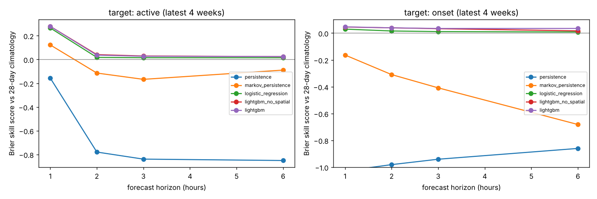
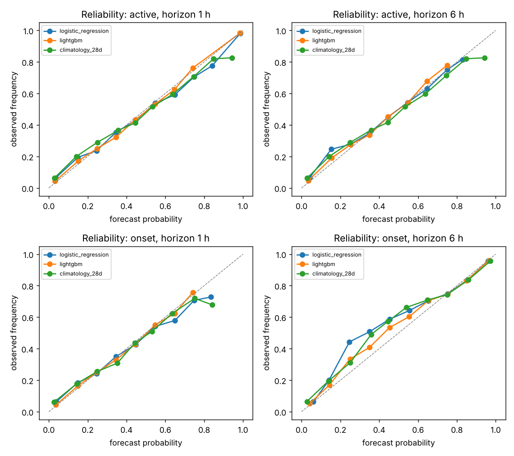
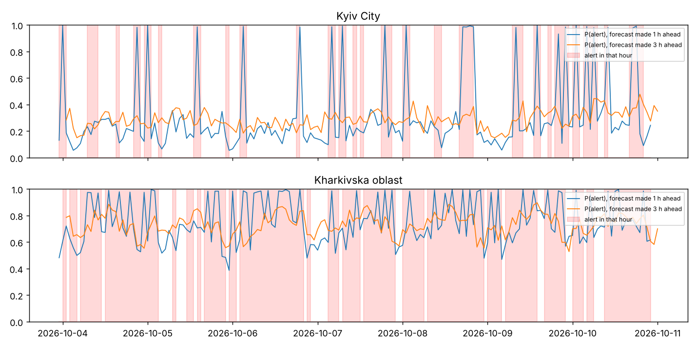
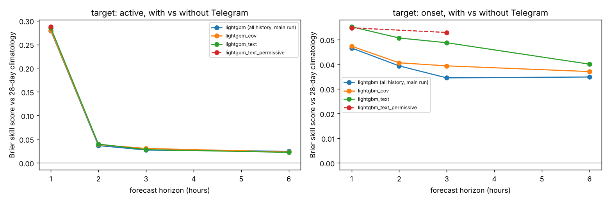
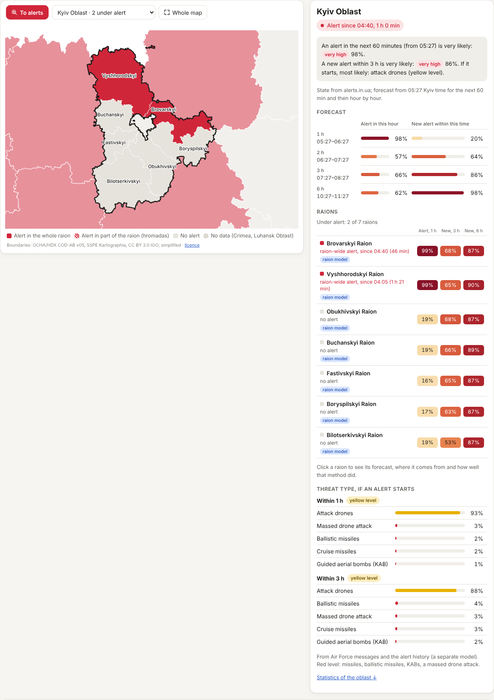
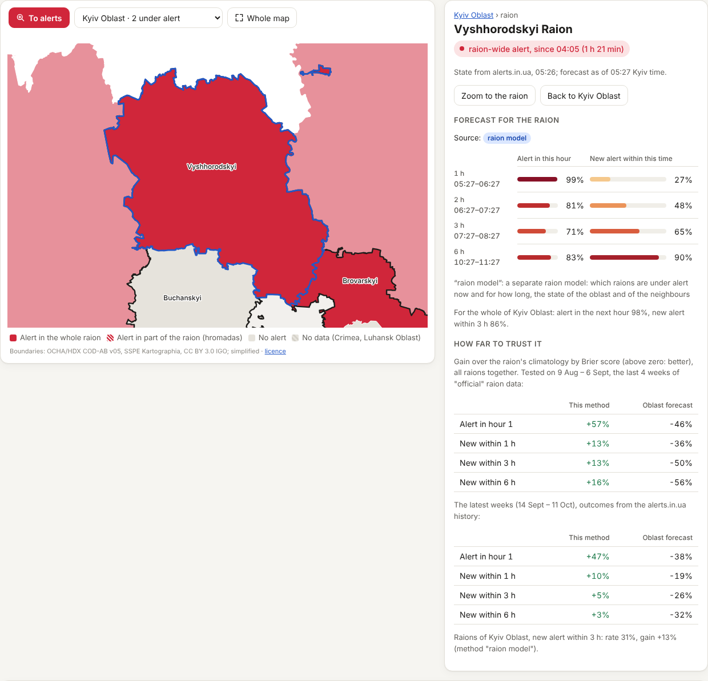

# Air raid alert forecasting for Ukraine

Per-region probabilistic forecasts of air raid alerts for the next 1–6 hours, refreshed
**every 10 minutes** (see [Automation](#automation)), built from the full alert history
since February 2022 and evaluated on the **latest four weeks** (12 Sep – 11 Oct 2026)
with a strict, leak-free walk-forward protocol.

Two questions are answered for each of 24 regions (23 oblasts + Kyiv City) at every
hour T:

| target | question | why |
|---|---|---|
| `active` | Will an alert be active at any moment of hour *T+h*? | what a person planning the next hours cares about |
| `onset`  | Will a **new** alert start within the next *h* hours? | harder and more useful: the "active" target is inflated by alerts that are already running |

A **raion (district) layer** adds which raions are under alert now and a 1–6 h forecast for
each of the 119 raions with data, evaluated on its own: see [Raion level](#raion-level-districts).

The web UI ([GitHub Pages](https://ivansnezhok.github.io/air-raid-forecast-ua/), or the
FastAPI app: [`docs/web-app.md`](docs/web-app.md)) is in **English by default** with a
Ukrainian switch (EN / UK in the header, remembered per viewer, or `?lang=uk`).

**What the percentages on the page mean.** Every forecast number is the probability of an
**air raid alert of any type** (attack drones, missiles, ballistic missiles, KABs…: the alert
records do not say which threat caused an alert) declared anywhere in the oblast or raion, for
the two targets above. The probabilities are calibrated: "70%" means that of past forecasts
around 70%, about 7 in 10 were followed by an alert
([`reports/figures/reliability.png`](reports/figures/reliability.png), and the calibration chart
on the "Model quality" page). It is not a share of the territory, of the hour, or the model's
confidence. The risk words are ranges of it (low < 15%, moderate 15–39%, high 40–69%, very high
≥ 70%). The history charts show a different quantity (how much of each hour or day was actually
under alert), and the threat-type block is conditional: *if* an alert starts, which threat it is
likely to be (shares add up to 100%; not the chance of an alert). Every forecast table has a
short line saying this and a "?" with the full definition; details and screenshots in
[`docs/web-app.md`](docs/web-app.md#що-означають-відсотки).

**Why this forecast.** Every oblast panel explains its numbers, from exactly the inputs the served
model saw at the forecast moment (`src/airraid/explain.py`, logged with the forecast to the store
kind `explanations`): the history-only probability next to the one shown when the Telegram model
served ("Telegram & news: 32% → 41%, +9 pp"), or why it did not; the served LightGBM's TreeSHAP
contributions (`pred_contrib`) summed into a few groups (alert now, own recent alerts, other
oblasts, time and usual level, Telegram for the oblast, Telegram nationwide), shown as bars that
push up or down with the factor on the odds (they add up in log-odds, not percentage points);
and a few live Telegram signals as counts. A raion panel shows its method and its oblast's
drivers. The "How it works" page is a short diagram plus a table of where the Telegram model
serves and what it gained (from `reports/text_selection.json` and `text_ablation_diff.csv`, via
`/api/method`). Screenshots: [`docs/web-app.md`](docs/web-app.md#чому-такий-прогноз).

## Quick start

```bash
pip install -r requirements.txt
python -m pytest            # leakage, verification, pipeline and web app tests (about 1.5 min)
python run.py               # full evaluation: model selection + 4-week walk-forward (about 30 min on 4 cores)
python run.py --reuse-selection   # skip model selection, reuse reports/selection.json
python predict_now.py       # live forecast for the next 6 hours (+ appends to the forecast log)
python verify.py            # score logged forecasts once their horizon has passed

# raion level (see "Raion level"): evaluation, latest-weeks check, static site with raions
python raion_run.py --threads 2             # → reports/raions/ (about 1 h on 4 cores)
python raion_latest.py --store live-data    # latest 4 weeks with alerts.in.ua labels

# with the point-in-time store (a checkout of the `live-data` branch, see "Live data")
git worktree add live-data origin/live-data
python predict_now.py --store live-data   # fills the hours after the dataset, logs to the store
python verify.py --store live-data        # verifies within hours instead of a day later
python -m airraid.collect poll --root live-data      # what the pipeline runs every 10 min (needs the token)
python scripts/train_models.py --out var/models      # what the train job runs (the served model set)
```

`predict_now.py` and the collector read an alerts.in.ua token from the
`ALERTS_IN_UA_TOKEN` environment variable only. The token is never stored in the repo
or printed.

Text signals (public Telegram channels, news), no account or key needed:

```bash
git worktree add text-data origin/text-data            # the point-in-time text archive
PYTHONPATH=src python -m airraid.text.collect update --root text-data   # new posts + news, < 1 min
PYTHONPATH=src python -m airraid.text.collect status --root text-data   # coverage, edited share
python run.py --text-root text-data --text-only         # Telegram ablation -> reports/text_ablation.md
python predict_now.py --text-root text-data             # live forecast with the Telegram model
```

## Data

* **Source:** the volunteer (eTryvoga) file of
  [Vadimkin/ukrainian-air-raid-sirens-dataset](https://github.com/Vadimkin/ukrainian-air-raid-sirens-dataset),
  116 k oblast-level alerts from 2022-02-25 to 2026-10-11 04:36 UTC.
* **Why not the "official" file from the same repo?** Checked before writing any code:
  1. it stopped updating on **2026-09-07**, so it cannot be used to evaluate on the latest period;
  2. since December 2025 most official alerts are declared per *raion* (district), so
     "an alert in the oblast" means something different before and after. The volunteer
     file is oblast-level for the whole war.
* **Cleaning** (`src/airraid/data.py`): Luhansk oblast is dropped (permanent alert since
  April 2022, almost no records) and Crimea is not in the data. Zero-length records are
  dropped. Alerts are capped at 12 hours: a few records last for days in western oblasts
  (177 h in Chernivtsi), which are missed "all clear" messages. The cap depends only on
  elapsed time, so it can be applied identically in real time. About 5 % of records have
  an imputed end (`naive=True`, start + 30 min); they are kept.

### Text signals: public Telegram channels and news

The alert history cannot see launches, so I added what people in Ukraine actually read
before an alert: the Air Force channel and volunteer "radar" channels, plus national
news. Everything is collected without an account (`src/airraid/text/`), stored in a
**point-in-time archive** on the `text-data` branch, and only text that was public
before the forecast origin is used.

| source | what it gives | history | in the model |
|---|---|---|---|
| [`kpszsu`](https://t.me/s/kpszsu) (Air Force, official) | "БпЛА курсом на …", ballistic threats, MiG-31K / Tu-95 take-offs, morning launch counts | 59,273 posts, complete from 2025-01-01 | yes |
| [`deraketaua`](https://t.me/s/deraketaua) (volunteer radar) | drone tracks, strategic aviation status, launch reports | 33,017 posts, complete from 2025-01-01 | yes |
| [`monitorwarr`](https://t.me/s/monitorwarr) (volunteer radar) | drone tracks, mostly Kyiv region | 15,531 posts, complete from 2025-01-01 | yes |
| [`war_monitor`](https://t.me/s/war_monitor) (volunteer) | ballistic threats with launch area, drone vectors | 23,168 posts, complete from 2025-01-01 | yes |
| [`raketa_trevoga`](https://t.me/s/raketa_trevoga) | mirror of the Air Force posts | live only: 99.6 % of posts are edited seconds after publishing (a footer), so the history cannot be timestamped | no |
| RSS: Ukrinform, Ukrainska Pravda, UNIAN, RBC-Ukraine | attack-related headlines | live only (a feed holds the latest items only) | no (not enough history yet) |
| GDELT DOC 2.0 API | attack-related headlines, crawl time | the API keeps 3 months, but it answers the dev sandbox and GitHub's shared runners with HTTP 429 most of the time: a 2.5-hour Actions run got 5 days (13-18 Jul 2026, 1,270 headlines) | no |

Not used: `UkraineAlarmSignal` (445 k posts since 2025; it mirrors the official alerts,
i.e. the target itself) and Suspilne's RSS (answers 403 to bots). The Kaggle "Massive
Missile Attacks on Ukraine" file now downloads (the old fetcher sent a browser
User-Agent, Kaggle answered with HTML), but nobody knows when each row appeared in it, so
it is only used to check the parser of the Air Force morning summaries (correlation of
nightly drone counts 0.92 over 554 nights); the model takes launch counts from the
summaries themselves, which carry their publish time.

**The archive** (`src/airraid/text/archive.py`): one JSONL record per post, partitioned
by month, with `date` (publish time), `first_seen_at`, `last_seen_at`, `text_first`,
`text_last`, `edited_first`, `edited_seen`, `collected_mode` (live / backfill). The
first-seen text is never overwritten; later sightings only update the `*_last` fields.
Each channel's `state.json` records the period for which we hold *every* post
(`complete_from` .. `complete_until`) and any gaps.

**When a text counts as public (`available_at`)**:

| how we got it | `available_at` | why |
|---|---|---|
| post, not edited when we first saw it (live or backfill) | publish time | the text we hold is the original one |
| post, already edited when we first saw it | first sighting | the web preview does not say when it was edited; the text we hold was public at the latest when we saw it. For backfilled posts this is after the whole test period, i.e. they are not used at all |
| news from RSS | first sighting | publish times in feeds are claims (backdated, re-timed, headlines rewritten) |
| news from GDELT | GDELT crawl time (`seendate`) | when the crawler saw it; never the claimed publish time |

Edited when first seen (`edited_first`, archive status on 2026-10-11): kpszsu 2.7 %,
deraketaua 29.2 %, monitorwarr 5.2 %, war_monitor 1.6 %, raketa_trevoga 99.6 %; 12,465 of
the 130,989 posts of the four model channels are therefore not used. Posts deleted by a
channel before our backfill are missing (a survivorship gap live collection does not have).

## Method

**Features** (`src/airraid/features.py`), all computed from what is known at T:

* current state: alert running now, how long it has been running, minutes since the
  last alert ended, alert starts in the last 6 h / 24 h / 7 d;
* own history: share of each of the last 24 hours under alert, share of the last
  24 h / 7 d / 28 d;
* national picture: number of regions under alert now, nationwide starts in the last
  1 h / 3 h, national share of the last 24 h;
* spatial picture: whether *each* of the 24 regions is under alert now and was in the
  last hour. The model learns which regions lead which, instead of a hand-written
  neighbour map;
* calendar: Kyiv local hour and day of week of the target hour; same-hour climatology
  over the last 7 / 28 days.
* Telegram (`src/airraid/text/features.py`, only in `lightgbm_text`): posts naming the
  oblast in the last 30 / 60 / 180 min, in total and by threat (drones, missiles,
  ballistic, guided bombs, all-clear); minutes since the oblast was last named with a
  threat; nationwide threat posts by class, how many oblasts were named in the last hour,
  strategic bombers / MiG-31K take-offs, nationwide ballistic threats, launch reports,
  "massed attack" wording, and the drone / missile counts of the latest morning summary.
  One regex lexicon (`src/airraid/text/lexicon.py`) serves these features and the
  threat-type labels. Origins outside the archive's coverage get NaN and
  `tg_covered = 0`, never zeros.

**Models** (`src/airraid/models.py`), one per target and horizon, pooled over regions:

| model | what it is |
|---|---|
| `climatology_28d` | share of the last 28 days with an alert (or onset) in the same hour(s) of the day. Reference for skill scores |
| `persistence` | 0/1: alert running now (`active`) / alert started in the last h hours (`onset`) |
| `markov_persistence` | P(event \| region, alert running now), fitted on the training window |
| `logistic_regression` | all features, trained on the last 12 months |
| `lightgbm_no_spatial` | gradient boosting without the national/spatial features (ablation) |
| `lightgbm` | gradient boosting, all features |
| `lightgbm_cov` | `lightgbm` trained only on origins from the start of the Telegram archive (2025-01-03): the fair baseline for the ablation |
| `lightgbm_text` | `lightgbm_cov` + Telegram features, same rows, same folds |

**Evaluation protocol** (`run.py`):

```
 ... training history (2022-03 → ) ... | validation 28 d | test 28 d (4 weekly folds) |
                                         2026-08-15       2026-09-12     2026-10-10 23:00 UTC
```

1. *Model selection* on the validation month: training window (3 / 6 / 12 / 24 months /
   all) and number of trees (early stopping) per target and horizon. The test month is
   not touched.
2. *Walk-forward test* on the last 28 days: four weekly folds; before each fold every
   model is retrained on data up to the fold start, as it would be in production.
3. *Embargo*: training origins stop 6 hours before the first evaluated origin, so no
   training label overlaps the evaluated period.
4. Metrics: Brier score, Brier skill score vs climatology, log loss, ROC-AUC, PR-AUC,
   reliability diagrams, per-region skill.

## How leakage is prevented, and tested

* **Construction:** every feature at T uses minutes strictly before T, plus the fact
  that an alert is running at T and how long it has run. The end time of an alert that
  is still running at T is never used.
* **Mechanical test** (`tests/test_leakage.py`): for random origins T the pipeline is
  rebuilt from data *truncated at T*, as if running live, and every feature must match
  the features computed from the full data. I checked that the test bites by injecting
  two leaks: a lag-0 feature, and "minutes since last alert ended" using the end of the
  running alert. Both made the test fail.
* **Sub-hour origins** (the 10-minute pipeline forecasts from any minute): the same
  truncation test at :10/:23/:40/:50 origins, a check that the hour blocks are exactly
  the minutes [T−60, T) and [T, T+h), and a mutation test that a feature reading the end
  of the running alert makes it fail (see "Automation").
* **Label test:** wiping all history before T must not change the labels.
* **Text features** (`tests/test_text_leakage.py`, synthetic archive, runs in CI):
  features at T recomputed from only the posts available before T must equal the
  features from the whole archive (also for the sensitivity rules); a post published at
  T, T + 1 min or T + 60 min changes nothing, one at T − 1 min does; turning the strict
  `< T` window or "minutes since" into `<= T` makes the checks fail, and so does a
  1-minute look-ahead (checked by hand); a post already edited when first seen counts
  only from that sighting; the first-seen text is never overwritten; uncovered origins
  and gaps are NaN; the live path and the evaluation path produce identical rows. The
  truncation check was also run on the real archive at 25 random origins (identical).
* **Label-not-a-feature test + guard:** see "What went wrong" below.

## Results (latest 4 weeks, walk-forward)

Test: forecast origins 2026-09-12 23:00 → 2026-10-10 23:00 UTC, 24 regions, about 16 k
forecasts per target and horizon. Brier score (lower is better); in brackets, the skill
vs the 28-day climatology (1 − Brier/Brier_clim). Full tables:
[`reports/metrics_test.md`](reports/metrics_test.md).

**Target `active`** (alert at any moment of hour T+h; base rate 33 %)

| model | h = 1 | h = 2 | h = 3 | h = 6 |
|---|---|---|---|---|
| climatology_28d | 0.184 | 0.184 | 0.183 | 0.183 |
| persistence | 0.212 (−16 %) | 0.327 (−78 %) | 0.337 (−84 %) | 0.339 (−85 %) |
| markov_persistence | 0.161 (+12 %) | 0.205 (−11 %) | 0.214 (−17 %) | 0.200 (−9 %) |
| logistic_regression | 0.135 (+27 %) | 0.180 (+2 %) | 0.181 (+2 %) | 0.181 (+1 %) |
| lightgbm_no_spatial | **0.132** (+28 %) | **0.176** (+4 %) | **0.178** (+3 %) | 0.179 (+2 %) |
| **lightgbm** | **0.132** (+28 %) | 0.177 (+4 %) | **0.178** (+3 %) | **0.179** (+2 %) |

**Target `onset`** (a new alert starts within h hours; base rate 23 % / 39 % / 50 % / 67 %)

| model | h = 1 | h = 2 | h = 3 | h = 6 |
|---|---|---|---|---|
| climatology_28d | 0.153 | 0.183 | 0.182 | 0.137 |
| persistence | 0.311 | 0.363 | 0.353 | 0.255 |
| markov_persistence | 0.178 | 0.240 | 0.256 | 0.230 |
| logistic_regression | 0.149 (+3 %) | 0.180 (+2 %) | 0.180 (+1 %) | 0.136 (+1 %) |
| lightgbm_no_spatial | 0.146 (+5 %) | **0.176** (+4 %) | 0.176 (+3 %) | 0.135 (+2 %) |
| **lightgbm** | **0.146** (+5 %) | **0.176** (+4 %) | **0.176** (+3 %) | **0.132** (+3 %) |

ROC-AUC of LightGBM: active 0.86 / 0.77 / 0.77 / 0.76, onset 0.78 / 0.80 / 0.81 / 0.86.





**What this means, honestly**

* LightGBM is the best model for every target and horizon, and its probabilities are
  well calibrated (reliability curves sit on the diagonal). LightGBM beat the logistic
  regression and a separately tested survival-hazard model by 0.002–0.005 Brier.
* The big win is only at **1 hour for `active`** (+28 % over climatology). Most of it
  comes from knowing what is happening *now*: an alert already running, how long it has
  lasted, how many alerts started this week.
* Beyond the next hour, and for predicting **new** alerts, the history of alerts alone
  adds only **2–5 % over a good climatology**. Alerts are driven by launches the
  history cannot see. The 28-day same-hour climatology already captures most of the
  predictable part: the night and early-morning drone waves and the regional pattern.
* Plain persistence is a poor probabilistic forecast, worse than climatology at every
  horizon. Calibrated "Markov" persistence helps only at 1 hour.
* **The spatial features (state of every other region) did not help**: the ablation
  without them scores the same. The national counters and the region's own history
  carry that information already.
* Top features by gain: onset climatology, alert starts in the last 7 days, hour-of-day
  climatology, alert running now, elapsed time of the running alert
  ([`reports/feature_importance_top30.csv`](reports/feature_importance_top30.csv)).
* **Pooled AUC flatters the model.** Much of it comes from telling high-alert regions
  from quiet ones. *Within* a region the onset-3h AUC is only 0.52–0.74 (median about
  0.6), and the skill over climatology ranges from −4 % (Zaporizhzhia) to +10 %
  (Ternopil). Zakarpattia had no onsets at all in the test weeks, so its skill score is
  undefined. See [`reports/metrics_by_region.csv`](reports/metrics_by_region.csv) and
  `reports/figures/skill_by_region.png`.

Validation-month model selection preferred long training windows (all history or
24 months) for almost every target. The 2022–2025 data still helps despite the 2026
regime shift: twice as many alerts, shorter alerts.

### With Telegram signals (ablation)

`python run.py --text-root text-data --text-only` ([`reports/text_ablation.md`](reports/text_ablation.md),
[`reports/text_sensitivity.md`](reports/text_sensitivity.md)). Same test weeks, rows and
weekly folds as above. `lightgbm_cov` (alert history only) and `lightgbm_text` (+ Telegram)
are trained on the same rows, origins from 2025-01-03 (the start of the Telegram archive)
to each fold start minus the 6 h embargo; trees are chosen on the validation month for
each model separately. Brier (skill vs climatology); Δ is text − history-only with a 95 %
interval from a bootstrap over days (forecasts within a day are correlated):

| target | h | lightgbm, all history (above) | lightgbm_cov | lightgbm_text | Δ Brier [95 % CI] | ROC-AUC cov → text |
|---|---|---|---|---|---|---|
| active | 1 | 0.1323 (+27.9 %) | 0.1321 (+28.0 %) | **0.1312** (+28.5 %) | −0.0009 [−0.0021, +0.0003] | 0.857 → 0.862 |
| active | 2 | 0.1768 (+3.7 %) | 0.1765 (+3.9 %) | **0.1763** (+4.0 %) | −0.0002 [−0.0014, +0.0010] | 0.772 → 0.774 |
| active | 3 | 0.1784 (+2.7 %) | **0.1778** (+3.1 %) | 0.1782 (+2.8 %) | +0.0005 [−0.0004, +0.0012] | 0.768 → 0.767 |
| active | 6 | **0.1787** (+2.5 %) | 0.1790 (+2.3 %) | 0.1792 (+2.2 %) | +0.0002 [−0.0009, +0.0012] | 0.764 → 0.764 |
| onset | 1 | 0.1462 (+4.7 %) | 0.1461 (+4.7 %) | **0.1449** (+5.5 %) | −0.0012 [−0.0024, +0.0000] | 0.779 → 0.788 |
| onset | 2 | 0.1761 (+3.9 %) | 0.1759 (+4.1 %) | **0.1740** (+5.1 %) | −0.0018 [−0.0037, −0.0001] | 0.798 → 0.806 |
| onset | 3 | 0.1756 (+3.4 %) | 0.1747 (+3.9 %) | **0.1730** (+4.9 %) | −0.0017 [−0.0039, +0.0006] | 0.815 → 0.821 |
| onset | 6 | 0.1320 (+3.5 %) | 0.1317 (+3.7 %) | **0.1313** (+4.0 %) | −0.0004 [−0.0032, +0.0025] | 0.865 → 0.866 |



**What this means, honestly**

* Telegram helps **a little, and only for new alerts in the next 1-3 hours**: about 1 %
  lower Brier, one more percentage point of skill over climatology (onset 1-3 h: +4.7 /
  +4.1 / +3.9 % → +5.5 / +5.1 / +4.9 %), ROC-AUC +0.006-0.009. The 95 % interval
  excludes zero only for onset at 2 h (at 1 h it touches zero). For "alert active in
  hour 3 or 6" there is no gain: those depend on alerts that are already running.
* It is not the breakthrough the README above hoped for ("alerts are driven by launches
  the history cannot see"). The posts mostly arrive **when** the threat is announced:
  Air Force posts naming an oblast are at the background rate until about an hour before
  an alert there, 15-25 % above it in the last hour, and twice the background only in the
  15 minutes right before the onset (sensitivity report, section 3). The few genuinely
  early signals (bomber and MiG-31K take-offs, launch reports, the size of last night's
  attack) carry some information but are rare. The most useful text features: minutes since the oblast was
  last named with a threat, how many oblasts were named in the last hour, the latest
  morning summary (how many drones last night, how long ago), minutes since the last
  nationwide ballistic threat / take-off ([`reports/text_feature_importance.csv`](reports/text_feature_importance.csv)).
  Text features take 16 % of the model's total gain.
* Almost all of it comes from the Air Force channel; the three volunteer radar channels
  add nothing measurable (sensitivity report, section 2).
* Calibration stays as good as without text (reliability error ≤ 0.0012 for both;
  [`reports/figures/text_reliability.png`](reports/figures/text_reliability.png)).
* The edit rule: dropping posts that were already edited when we first saw them costs at
  most 0.3-0.4 points of the improvement compared with a deliberately leaky variant that
  uses them at publish time (sensitivity report, section 1).
* **Served live:** the text model is used where it beat the history-only model on the
  *validation* month: every target and horizon except `active` at 6 h (a rule fixed before
  looking at the test weeks). On the test weeks those seven are also better than the
  all-history model that served until now; for `active` at 6 h the history model stays.

## Live data

### Which live records count as "an alert in the oblast"

The model is trained on the volunteer file. Live, alerts.in.ua reports alerts per oblast,
raion, hromada and city, and keeps some frontline raion/hromada alerts open for weeks
(on 2026-10-11: a Kharkivska hromada since 2026-03-10, two Dnipropetrovska hromadas since
2026-09-17). The live state must mean what it means in training, so the definition was
measured, not assumed (`scripts/live_definition_check.py`, using the official
raion-level file of the same upstream repo, Dec 2025 – Sep 2026, and the real
alerts.in.ua history kept in the store, Sep – Oct 2026):

* **Oblast-level records alone do not work.** Since December 2025 alerts are declared per
  raion: outside Kyiv City the official file has *no* oblast-level records, so 1 % of
  volunteer alert starts match one (3-minute window), while the volunteer file has 3–14
  alerts a day per frontline oblast.
* **The volunteer file is a Telegram channel replayed per oblast:** any "alert" post for
  any part of the oblast opens (or restarts) the oblast's alert, the next all-clear post
  for any part closes it (upstream `volunteer_etryvoga_processor.py`). Measured: 87 % of
  volunteer alert *ends* coincide with an official all-clear somewhere in the same oblast
  (97 % in Kharkivska), but only 49 % of *starts* with an official activation (the channel
  also posts threat notices that are not sirens). The real alerts.in.ua feed shows the same
  (Sep 12 – Oct 11 2026): 1 % of starts match an oblast-level record, 86 % of ends an
  all-clear of any level.
* **Rule used** (`airraid.live_alerts.oblast_intervals` / `model_alerts`): replay every
  `air_raid` record of any level through the same rules: the latest activation starts the
  oblast alert, an all-clear for any part ends it, and with no new activation it is over
  after **1 hour** (`LIVE_EXPIRY_HOURS`, never more than the 12 h cap of `load_alerts`).
  A month-old frontline record can therefore never make an oblast "active".

Rules compared on hourly origins, official file Dec 2025 – Sep 2026 (volunteer:
104 alerts/day, mean 0.56 h, alert running at 10.4 % of origins):

| rule | alerts/day | mean length | share of origins under alert | Cohen's κ vs volunteer |
|---|---|---|---|---|
| oblast-level records only | 2 | 0.97 h | 0.3 % | 0.03 |
| any record, 12 h cap (old merge + cap) | 362 | 1.99 h | 27.5 % | 0.46 |
| latest activation until all-clear, 12 h | 96 | 0.96 h | 16.3 % | 0.60 |
| **same, 1 h expiry (used)** | 96 | 0.57 h | 9.8 % | 0.52 |

κ alone favours a 12 h expiry, so the expiry was chosen by what matters: a LightGBM
trained on the volunteer file before the period, scored against volunteer labels with its
inputs rebuilt from each rule (`--model`; "state only": the running-alert features;
"all recent": every feature, as when the store fills a whole gap). Mean Brier over the
8 target × horizon pairs (volunteer inputs = the floor):

| period, source | volunteer inputs | oblast only | any record, 12 h | latest until clear, 12 h | **…, 1 h** |
|---|---|---|---|---|---|
| Jan–Apr 2026, official (selection) – state only | 0.1377 | 0.1455 | 0.1492 | 0.1442 | **0.1433** |
| Jan–Apr 2026, official (selection) – all recent | 0.1377 | 0.2664 | 0.1751 | 0.1585 | **0.1517** |
| May–Sep 2026, official – state only | 0.1399 | 0.1473 | 0.1528 | 0.1474 | **0.1458** |
| May–Sep 2026, official – all recent | 0.1399 | 0.2895 | 0.1849 | 0.1661 | **0.1601** |
| Sep 20 – Oct 11 2026, alerts.in.ua – state only | 0.1643 | 0.1726 | 0.1829 | 0.1776 | 0.1730 |
| Sep 20 – Oct 11 2026, alerts.in.ua – all recent | 0.1643 | 0.2694 | 0.2069 | 0.1921 | **0.1825** |

Expiries of 1, 2, 3, 6 and 12 h were tried. On the selection period 1 h was best for
"all recent" (0.1517 vs 0.1531 for 2 h) and within 0.0001 of the best (2 h) for "state
only"; it is the best of the five on both later periods. Two honest caveats: the live
rule is a noisy stand-in for the volunteer channel (active-1h Brier 0.19 vs 0.14 with
the true volunteer state on the real feed), and on the real feed "state only" ties with
"assume calm" (oblast only), so most of the gain comes from filling the gap. The volunteer
file restarts an alert at the *last* post before the all-clear, which is only known after
the fact; live, the rule can only use the last activation before the forecast time.

### Point-in-time store (`src/airraid/store.py`, branch `live-data`)

Everything the live system sees or says is kept, with the moment it became known, on the
orphan branch `live-data` (`.github/workflows/pipeline.yml`: a poll every 10 min;
`collect.yml`: the alerts.in.ua history once a day; the API only keeps ~30 days, so it
was backfilled on 2026-10-11 from 2026-09-11):

```
live-data/<kind>/<YYYY-MM-DD>/<stamp>-<hash>.parquet   one immutable file per append (UTC day)
  polls           observed_at, status, n_records, levels     one row per active.json poll
  alerts_active   every record of every poll, all levels and alert types, observed_at
  alerts_history  month_ago records, fetched_at; deduplicated on append
  history_pulls   fetched_at, uid, status                    one row per history request
  forecasts       origin, issued_at, region, target, horizon, p, clim, active_now,
                  trained_until, hist_end, git_sha, live
  verification    scored forecasts, verified_at, label_source
live-data/_state/history.json   collector bookkeeping (resume, If-Modified-Since)
live-data/_state/pipeline.json  the last pipeline run: time, step timings, data ends (= the site's api/status.json)
```

`store.load(root, kind, as_of=T)` returns only rows known at T (`observed_at` /
`fetched_at` / `issued_at` ≤ T); for `alerts_history` it resolves each record (uid,
start, type) to the version known at T, with `first_seen_at` and `known_at` (when its end
became known). Files are never rewritten, so git grows only by new rows.

### What is and is not leak-free

* **Training never sees live data.** Models are fit on the volunteer file only, on origins
  whose label window it fully covers (`airraid.training`, `predict_now.grids`). Before this fix the training
  grid included the live records: frontline oblasts got weeks of fake "alert running, no
  new alert" rows, and the hourly run forecast `active` 0.999 / `onset` 0.000 for 6 h in
  Dnipropetrovska and Kharkivska, which have about 20 alerts a day.
* **Prediction features at origin T** may use, besides the dataset: store rows known at T
  (`first_seen_at`, `observed_at` ≤ T; an end is used only if it is ≤ T and was known at
  T) and a fresh poll's records that started before T (their disappearance after T is not
  used). They are added only after the dataset ends and never overlap a dataset record
  (`live_alerts.after_dataset`), so live data cannot rewrite history.
* **Not leak-free, by design:** verification labels. `verify.py` looks up outcomes after the
  fact (that is its job); the probability it scores is the one logged at issue time.
* **Approximate:** store-based labels (`label_source = "store"`) and gap features come from
  the live rule above, not from the volunteer channel; alerts that start and end between
  two polls are missing until the daily history pull. Dataset labels replace store
  labels once the dataset covers the window.

## Raion level (districts)

Picking an oblast on the web map zooms to it and breaks it down into its **raions** (the
136 districts after the 2020 reform, plus Kyiv City and Sevastopol): which raions are under
alert right now (the whole raion, or only some of its hromadas: striped), since when, and
a 1/3/6 h forecast for every raion with the method behind the number; clicking a raion
opens its own panel. The "Raions" view colours the whole country by raion, and **"To
alerts"** zooms the map to the raions under alert, in all oblasts or in one. The page is
in English by default, with a Ukrainian switch (EN / UK, remembered per viewer,
`?lang=uk|en`). Screenshots and API: [`docs/web-app.md`](docs/web-app.md#райони).




### Geometry and names

* `scripts/build_map.py` → `src/airraid_app/static/ukraine-map.json` (country view, loaded
  with the page: 150 KB, 51 KB gzipped) and `ukraine-map-detail.json` (loaded the first time
  the map zooms in: 290 KB, 83 KB gzipped), both from the OCHA/HDX **COD-AB** boundaries of
  Ukraine, v05, valid on 2025-09-01 (State Scientific Production Enterprise "Kartographia",
  **CC BY 3.0 IGO**, [`ukraine-map.LICENSE.txt`](src/airraid_app/static/ukraine-map.LICENSE.txt)).
  Neighbours share their border vertices, so borders are cut into arcs and every arc is
  simplified once (as TopoJSON does, 0.3 km / 45 m tolerance for the two levels): no gaps or
  slivers between raions. The **oblasts are the raions dissolved** (the same arcs), so oblast
  and raion borders coincide exactly; Kyiv City is a real outline cut out of Kyiv Oblast.
  The files store the arcs once (delta-encoded integers) and the rings as arc indices; the
  UI builds the SVG paths. The Chornobyl exclusion zone is drawn as part of Vyshhorodskyi
  raion, which it belongs to since 2020. `tests/app/test_map_geometry.py` checks
  completeness, closed rings, no overlaps and that every oblast equals its dissolved raions.
* `src/airraid/raions.py`: one row per unit with the HDX pcode, the oblast, the English
  name of the official alert file and the Ukrainian title and location UID of
  alerts.in.ua. **Mapping completeness** (`tests/app/test_raion_map.py`): all 118 raions of the
  official file (three renamed since: Krasnohradskyi → Berestynskyi, Chervonohradskyi →
  Sheptytskyi, Volodymyr-Volynskyi → Volodymyrskyi), all 126 alerts.in.ua raion UIDs,
  all 1,469 alerts.in.ua hromadas (through their raion) and the 7 city-level UIDs seen in
  the alerts.in.ua history (Kharkiv, Dnipro, Kryvyi Rih, Nikopol, Marhanets,
  Zaporizhzhia, Svitlovodsk). **Unmatched: none.** Not forecast, drawn as "no data":
  Crimea (10 raions; one location in alerts.in.ua), Sevastopol and Luhansk oblast (8
  raions; permanent alert since 2022, excluded from the oblast model too).

### Raion-level history

* **Official file** of the same upstream repo (`official_data_en.csv`, oblast / raion /
  hromada records, 2022-03-15 → 2026-09-07 05:00 UTC, then it stopped updating) and the
  **alerts.in.ua history** in the point-in-time store (`live-data`, from 2026-09-12 on,
  pulled per oblast; see "Live data"). Between them, 7–12 Sep 2026 is a gap that is
  tracked as such, never treated as "no alerts".
* `src/airraid/raion_data.py` maps every record to the raions it covers: an oblast-level
  record → every raion of the oblast, a raion record → that raion, a hromada or city
  record → its raion (only part of it, but that is what a resident sees). Same cleaning
  as the oblast data: zero-length records dropped, **12 h cap** (frontline records that
  stay open for weeks count as over after 12 h, live and in training alike).
* **Coverage** (`reports/raions/coverage.csv`): every oblast except Luhansk has raion-level
  declarations; at least 90 % of its records have been below oblast level since
  **Aug 2025** (Kharkivska, Kyivska, Poltavska), **Sep 2025** (Chernihivska,
  Dnipropetrovska, Khmelnytska, Kirovohradska, Sumska) or **Nov 2025** (the other 15).
  Before that most alerts were oblast-wide, so every raion of the oblast counts as under
  alert. Kyiv City is one unit. The official file has no records for Ivano-Frankivska,
  Lvivska and Zakarpatska after 2026-08-07 (quiet weeks there, or a gap in the file);
  the volunteer file has 154 Lvivska alerts over 10 Aug – 7 Sep.
* **The two files disagree about "an alert in the oblast"** (`reports/raions/
  agreement.csv`, minutes of 10 Aug – 6 Sep 2026): in Dnipropetrovska, Kharkivska, Sumska
  and Zaporizka some raion is under an official alert 71–84 % of the time, the volunteer
  oblast alert only 13–24 %; in Lvivska and Volynska the volunteer file has an alert
  ~15 % of the time while official raion alerts cover < 0.3 %. A raion forecast cannot
  just reuse the oblast probability; this is handled below by learning the raion's own
  labels and by a ratio estimator for the share.

### Method

`raion_run.py` (same protocol as `run.py`): the last 4 weeks with official raion data
(origins 2026-08-09 19:00 → 2026-09-06 19:00 UTC) as the test, the 4 weeks before as
validation, weekly refits, 6-hour embargo, 119 units (118 raions + Kyiv City). Targets as
for oblasts (`active`: raion under alert in hour T+h; `onset`: a new raion alert within h
hours). Compared:

| method | what it is | needs at forecast time |
|---|---|---|
| `climatology_28d` | raion's same-hour share of the last 28 days (skill reference) | 28 days of raion history |
| `persistence` | 0/1: raion under alert now / alert started in the last h hours | current raion state |
| `oblast` | the oblast model's probability, as is (refit at each fold exactly as served) | nothing raion-level |
| `oblast_x_share` | oblast probability × the raion's trailing 28-day ratio of raion events to (volunteer) oblast events; the ratio estimator absorbs the definitional mismatch (calibrated on average) | a share from some 28 days of raion history |
| `oblast_x_share_stale30` | the same with the share estimated 30 days earlier (how a stale share degrades) | as above |
| `lightgbm_state` | raion LightGBM on what one alerts.in.ua poll gives: which raions are under alert now and for how long, share of the other raions of the oblast and of the bordering raions under alert, the volunteer oblast's state and recent history, calendar | **current raion state only** |
| `lightgbm` | the same plus 28 days of raion history (lags, counts, same-hour climatology) | 28 days of raion history |

What can run live depends on the data at hand, so the validation month picks the best
method for three tiers: **history** (the store covers the last 29 days), **live_state** (a
poll, no recent history), **none** (no live raion data). The app serves the tier's choice
and falls back down the list when an input is missing. Kyiv City is one unit but is treated
like a raion: its raion target is the official city alert, and the raion models beat the
oblast model there too. Every value in `/api/raions` carries its method, and the UI shows it.

### Results

**Test 1: official raion file, latest 4 weeks it covers** (origins 2026-08-09 19:00 →
2026-09-06 19:00 UTC, 119 units, ~80 k forecasts per target and horizon; full tables
[`reports/raions/metrics_test.md`](reports/raions/metrics_test.md)). Brier score, in
brackets the skill vs the raion's 28-day same-hour climatology:

| target, horizon | climatology | oblast forecast as is | oblast × share | **raion model, current state** | **raion model + 28-day history** |
|---|---|---|---|---|---|
| active 1 h | 0.140 | 0.204 (−46 %) | 0.169 (−21 %) | **0.060 (+57 %)** | **0.057 (+59 %)** |
| active 3 h | 0.140 | 0.174 (−24 %) | 0.153 (−9 %) | 0.101 (+28 %) | **0.097 (+31 %)** |
| active 6 h | 0.140 | 0.171 (−22 %) | 0.153 (−9 %) | 0.112 (+20 %) | **0.111 (+21 %)** |
| onset 1 h | 0.087 | 0.119 (−36 %) | 0.088 (−1 %) | 0.076 (+13 %) | **0.074 (+16 %)** |
| onset 3 h | 0.152 | 0.228 (−50 %) | 0.154 (−1 %) | 0.132 (+13 %) | **0.124 (+18 %)** |
| onset 6 h | 0.166 | 0.259 (−56 %) | 0.168 (−1 %) | 0.139 (+16 %) | **0.131 (+21 %)** |

Base rates: active 28 %, onset 10 % / 25 % / 37 % (1 / 3 / 6 h). ROC-AUC of the raion
models 0.85–0.97. A less noisy baseline, the raion's event rate over the last 28 days at
any hour (`rate_28d`), is only 1–3 % better than the same-hour climatology, so the skill is
not an artefact of a noisy reference. The share is worse when it is 30 days stale (onset
−3 to −5 %). Reliability curves of both raion models sit on the diagonal
([`reports/raions/figures/reliability.png`](reports/raions/figures/reliability.png)).

**Test 2: the latest 4 weeks, labels from alerts.in.ua** (`raion_latest.py`, origins
2026-09-13 23:00 → 2026-10-10 23:00 UTC, the same weeks as the oblast model's test,
77 k forecasts per target and horizon; [`reports/raions/latest_metrics.md`](reports/raions/latest_metrics.md)).
Only methods that need no 28-day raion history can run here (7–12 Sep is a gap); the
reference is the same-hour climatology over the days of the last 28 that have raion data.
The current-state model is refit weekly on everything known before the fold (official
file + store):

| target, horizon | climatology (available days) | oblast forecast as is | oblast × share | **raion model, current state** |
|---|---|---|---|---|
| active 1 h | 0.160 | 0.221 (−38 %) | 0.198 (−24 %) | **0.085 (+47 %)** |
| active 3 h | 0.160 | 0.194 (−22 %) | 0.182 (−14 %) | **0.139 (+13 %)** |
| active 6 h | 0.160 | 0.195 (−22 %) | 0.185 (−16 %) | **0.150 (+6 %)** |
| onset 1 h | 0.124 | 0.147 (−19 %) | 0.123 (+1 %) | **0.112 (+10 %)** |
| onset 3 h | 0.177 | 0.223 (−26 %) | 0.177 (0 %) | **0.168 (+5 %)** |
| onset 6 h | 0.166 | 0.218 (−32 %) | 0.163 (+1 %) | **0.161 (+3 %)** |

**What this means, honestly**

* **The oblast probability is not a raion forecast.** Used as is it is worse than the
  raion's own climatology at every horizon (−19 % to −56 %), mostly because the volunteer
  oblast alert and official raion alerts are different events (see the mismatch above).
  Multiplying by the raion's share fixes the calibration on average but adds no skill.
* **A raion model is clearly better.** In the current-state model the gain (LightGBM
  "gain", top 30 features) goes to the raion's identity, i.e. a learnt per-raion base rate
  and its interactions (43 %), to whether the raion is under alert now and for how long
  (22 %), to the oblast's recent activity from the volunteer file (~16 %) and to how many
  raions nationwide and next door are under alert (~7 %); the other raions of the same
  oblast add < 1 % once the neighbours are known. The 28-day-rate baseline barely beats the
  climatology, so the base rate alone does not explain the skill
  ([`reports/raions/feature_importance_top30.csv`](reports/raions/feature_importance_top30.csv)).
* **28 days of raion history add a little** (onset +3 to +5 points over the current-state
  model) but are rarely available live, because the store must cover the last 29 days
  without gaps. The current-state model needs one poll, so it is what normally serves.
* **On the latest weeks the gain is smaller** (onset +3 to +10 %, active +6 to +47 %): the
  model learnt mostly from the official file, alerts.in.ua records include city-level
  and long frontline alerts, and alert activity was higher (active base rate 39 % vs 28 %).
  It is still better than every alternative at every horizon.
* **Where raion data is thin:** Ivano-Frankivska, Lvivska and Zakarpatska had almost no
  official raion alerts in the test weeks (skill undefined); the per-oblast numbers are in
  [`reports/raions/by_oblast.csv`](reports/raions/by_oblast.csv) and
  [`latest_by_oblast.csv`](reports/raions/latest_by_oblast.csv). Without any live raion
  data the app falls back to oblast × share and says so in the panel; that fallback is
  worse than climatology for `active` (see the tables), which is stated next to it.

**What serves which raion forecast** (validation month, chosen per data tier; identical for
all targets and horizons):

| data at forecast time | method served |
|---|---|
| store covers the last 29 days (+ live poll) | raion model + 28-day history |
| live alerts.in.ua poll (token) | raion model, current state |
| neither | oblast forecast × the raion's share (period shown) |

The validation numbers that drove the choice are optimistic for the LightGBM models (early
stopping on the same month); the test numbers above are not.

### No leakage at raion level

* Same construction as the oblast features: at origin T only minutes before T, plus which
  raions are under alert at T and since when; the end of a running alert is never used.
  Raion and volunteer records are cut at T (`raion_data.alerts_as_of`); store rows are
  taken as known at T (`store.load(as_of=T)`); shares use only label windows that end by T.
* `tests/test_raion_leakage.py` (real data): for random origins in 2026 every raion feature
  and the trailing share are rebuilt from data cut at T and must equal the full-data
  values. Two injected leaks make it fail (the hour starting at T as a feature; a share
  over label windows not finished at T). `tests/app/test_raions.py` has an offline twin
  that CI runs.
* Training never sees live data (as for the oblast model): the raion models learn from the
  raion history and the volunteer dataset only, and stop where both end.

### Commands

```bash
python scripts/build_map.py                 # oblast + raion geometry, two levels of detail (outputs committed;
                                            # --write-neighbours also rewrites the raion neighbour list)
python raion_run.py --threads 2             # official-file walk-forward → reports/raions/ (~1–2 h on 4 cores)
git worktree add live-data origin/live-data
python raion_latest.py --store live-data    # latest 4 weeks with alerts.in.ua labels → reports/raions/latest_*
AIRRAID_STORE=live-data python scripts/build_static_site.py site   # site incl. api/raions*.json
```

The web app reads `reports/raions/summary.json` for the chosen methods and plans; without
it, it serves the current-state model with defaults. `AIRRAID_STORE` (same variable as
`predict_now.py`) adds the store's raion history; `ALERTS_IN_UA_TOKEN` gives the live
raion state; `AIRRAID_RAION_MODELS=0` skips raion model training on small hosts.
`RaionForecaster.save(dir)` / `load_saved(dir)` persist the raion models and shares, so a
separate job can train them and a site build can serve them without training
(`AIRRAID_RAION_TRAIN=0`, models from `AIRRAID_RAION_MODEL_DIR`, default
`<AIRRAID_MODEL_DIR>/raions`; without saved models the raion forecast is oblast × share,
labelled `models_source: "none"` in `/api/raions`).

## Learning loop (live)

* `predict_now.py` forecasts the next 6 hours for every region and appends each forecast
  to `reports/forecast_log.csv` and, with `--store`, to the store's `forecasts`. The
  origin is the first whole minute after the newest poll, so the 10-minute pipeline
  issues a new forecast every run (see "Sub-hour origins" below).
* **Retraining is a periodic refit**, not online learning: the train job
  (`.github/workflows/train.yml`, `scripts/train_models.py`) refits the models from
  scratch on the volunteer file as known at that moment, daily and whenever the dataset
  has 6 h more data than the served models; everything else only loads that bundle
  (`airraid.training`, `--models var/models`, not committed).
* `verify.py` looks up what actually happened once a forecast's horizon has passed and
  writes `reports/verification.csv` and `reports/verification_summary.json`: Brier of
  the model vs climatology over the last 24 h / 7 d / all time, hit rate, recall and
  false alarm ratio at p ≥ 0.5. With `--store` it reads the forecasts from the store,
  labels windows after the dataset end from the store's alerts.in.ua records (so within
  hours instead of a day later), and appends the result to the store. **Verification is
  monitoring:** it does not feed back into model weights. `tests/test_verify.py` checks
  that it uses exactly the training labels.
* `predict_now.py --as-of 2026-10-10T12:20` replays the live path at a past minute: data
  after it is dropped, store rows are used as they were known then, and models are
  retrained on the truncated dataset.
* **Telegram model** (`--text-root text-data`, or `AIRRAID_TEXT_ROOT` for the web app):
  before forecasting, the newest posts are fetched into the archive (and kept there),
  the text features at the origin are built by the same code `run.py` evaluates, and the
  history + Telegram model (`src/airraid/text/serving.py`, trained like `lightgbm_text`,
  cached in `models/text/`) makes the forecast. If the fetch failed, the collection is
  stale or has a gap at the origin, or the boosters do not match the features, the
  history-only model serves instead. Which one served is in the forecast log (`model`),
  in `reports/forecast_meta.json` (`model_served`, `text_status`) and in the API
  (`model.served`, `model.text_status`). With `AIRRAID_TEXT_TRAIN=0` the text models are
  never trained in the forecast run: the boosters a separate job saved
  (`python -m airraid.text.serving train --root text-data --model-dir <models>/text`) are
  served whatever their age, else the history-only model, and `text_status` says so.

## Automation

Everything runs on GitHub Actions; nothing needs a laptop or a server.

```
 every 10 min (:03, :13, ...)   keep-alive / pinger / by hand
            │                              │
            ▼                              ▼
 pipeline.yml ── gate ── skip if the last update is < 5 min old (duplicate trigger)
            │
            ▼ run (one at a time: concurrency group, never cancelled)
   1 check out the store            live-data, tip only: 31 days of observations, 10 of outputs
   2 restore the served models      Actions cache  ◄──────────── train.yml (daily, on new data, by hand):
   3 download the dataset                                          oblast models + holdout week, raion
     (+ official raion file, cached)                               models, history + Telegram models
   4 poll alerts.in.ua              → store: polls, alerts_active
   5 update the text archive        → text-data: new Telegram posts and news (pipeline = only writer),
                                      fetched once the origin minute has begun (0–60 s wait)
   6 forecast (predict_now.py)      → store: forecasts, with the served model per row (history-only
                                      or history + Telegram); trains once only if no oblast models
   7 threat type (after 6)          P(onset) × P(type | onset), same origin, posts from text-data
   8 verify (verify.py)             → store: verification     (24 h / 7 d Brier vs climatology, hit rate)
   9 build the static site          same models, forecast and verification; raion layer with the
                                      saved raion models (store mode, AIRRAID_*_TRAIN=0: no training)
  10 status.json                    → site api/status.json + store _state/pipeline.json
  11 commit live-data and text-data new partitions / archive files, rebase-and-retry
  12 dispatch train.yml             if the dataset has 6 h more data than the models, or a layer is missing
            │
            ├─ deploy ── GitHub Pages (main only)
            └─ keep-alive ── wait for the next slot + 3 min; if nothing started a newer run, dispatch one
 collect.yml (daily 02:41)  alerts.in.ua 30-day history → store (alongside the pipeline, own _state file)
```

| what | where it lives | written by |
|---|---|---|
| polls, active alerts, history pulls, forecasts, verification, run status | branch `live-data` (append-only parquet, `src/airraid/store.py`) | pipeline, collect-history |
| Telegram posts and news, as first seen | branch `text-data` (`src/airraid/text/archive.py`) | pipeline (text-collect.yml by hand) |
| served model bundle: oblast models (`airraid.training`), `raions/`, `text/` | Actions cache `models-v2-<code hash>-<data end>-<trained at>` | train.yml (pipeline only as a fallback, oblast models only) |
| official raion-level file (stopped updating 2026-09-07) | Actions cache `official-data-en-v1` | pipeline / train job, downloaded once |
| the site (`api/*.json`, UI) | GitHub Pages | pipeline (deploy job) |
| Air Force posts (threat-type model) | branch `threat-labels-data` | threat-labels.yml |

**Cadence and timings.** A run starts every 10 minutes and takes about a minute; measured
on GitHub-hosted runners on 11 Oct 2026 (runs 2, 4 and 5 of the end-to-end test):

| step | seconds |
|---|---|
| setup: checkout, Python, packages (pip cache), model cache restore | 23–26 |
| check out the store (last 10 days, no blobs) | 0.5–0.9 |
| download the dataset / poll alerts.in.ua | 0.6–0.8 / 0.7–0.8 |
| forecast with the cached models | 3.3–3.5 |
| threat-type forecast (retrains its two small models) | 25–27 |
| verify | 1.8–1.9 |
| build the static site | 5.4–6.0 |
| **run job, start to store commit** | **67–72** |

The gate job takes 3–6 s. Without a model cache (first run, changed modelling code) the
forecast step trains the serving models itself in about 90 s; the train job (holdout
week + final refit) takes about 3.5 minutes. The forecast is logged about 3 s after the
poll and the site is built about 40 s after it.

**Sub-hour origins.** The forecast origin is the first whole minute after the newest poll
(`airraid.nowcast`), so every run forecasts "the next 60 minutes from 14:13", not the
14:00 forecast again. Every feature and label is defined on hour blocks of the minute
grid; `data.build_grid` shifts the grid start so that the blocks end exactly at the
origin (the lags at 14:13 are 13:13–14:13, …, hour 1 is 14:13–15:13), and the calendar
features use the Kyiv hour of the target block's midpoint (unchanged for top-of-hour
origins, so training is unchanged). Nothing after the origin is used: store rows known
at the origin (≤ origin) and records that started before it. The truncation test now
also runs at :10/:23/:40/:50 origins, an independent check confirms the blocks are the
minutes [T−60, T) and [T, T+h), and a mutation test confirms the check fails for a leaky
feature (`tests/test_leakage.py`). Models trained on top-of-hour origins stay calibrated
off the hour (`scripts/backtest_subhour.py`, every origin of 13 Sep – 11 Oct 2026 at each
offset, models trained on data before it):

| target | h | Brier :00 | Brier :20 | Brier :40 | skill :00 | skill :20 | skill :40 | ECE :00 | ECE :20 | ECE :40 |
|---|---|---|---|---|---|---|---|---|---|---|
| active | 1 | 0.1323 | 0.1308 | 0.1308 | +0.278 | +0.288 | +0.286 | 0.012 | 0.011 | 0.013 |
| active | 3 | 0.1781 | 0.1781 | 0.1775 | +0.027 | +0.030 | +0.031 | 0.014 | 0.012 | 0.016 |
| onset | 1 | 0.1467 | 0.1468 | 0.1465 | +0.044 | +0.047 | +0.046 | 0.013 | 0.011 | 0.012 |
| onset | 3 | 0.1751 | 0.1752 | 0.1746 | +0.034 | +0.031 | +0.033 | 0.023 | 0.023 | 0.023 |
| onset | 6 | 0.1326 | 0.1319 | 0.1318 | +0.025 | +0.026 | +0.029 | 0.024 | 0.024 | 0.023 |

(all offsets :00–:50 and horizons in `reports/subhour_backtest.md`; skill = Brier skill vs
the 28-day climatology, ECE = expected calibration error, 10 bins). No offset is worse
than :00 by more than 0.0015 Brier, so the models are not retrained on mixed-phase origins.

**Why a keep-alive, and why it is bounded.** GitHub runs `schedule` best effort: in this
repository the hourly forecast cron (`7 * * * *`) fired twice between 08:40 and 22:30 UTC
on 11 Oct 2026, the 3-hourly Pages cron 48 minutes late, the 30-minute Telegram cron
twice. A 10-minute site cannot rely on it. The layers, from most to least reliable:

1. **External pinger** (recommended, needs the owner): cron-job.org calls the
   `workflow_dispatch` endpoint every 10 minutes with a fine-grained token that can only
   run Actions in this repository (step by step in `deploy/README.md`).
2. **Keep-alive** (on by default): after every run (also one the gate skipped as a
   duplicate) a small job waits until the next slot + 3 minutes, checking every 20 s,
   and dispatches the workflow only if nothing (cron, pinger, a person) has started a
   newer run by then; as soon as a newer run appears it exits. It is a dead man's
   switch, not a loop: runs never overlap (one concurrency group), a chain of runs
   started only by the keep-alive stops after `PIPELINE_KEEPALIVE_MAX_HOPS` (default
   72, about 12 hours) until a real trigger restarts it, and `PIPELINE_KEEPALIVE=off`
   disables it. In the end-to-end test (PR #10) a run finished at 22:49, nothing else
   started one for the 22:53 slot, and the keep-alive dispatched the next run at
   22:56:02, which ran normally and continued the chain.
3. **`schedule`** every 10 minutes at :03/:13/… (off the congested top of the hour).

Terms: Actions minutes on standard runners are free and unlimited for public
repositories, jobs are capped at 6 hours (ours: 30 minutes, the keep-alive 20), at most
one pipeline run executes at a time, and the work is the project's own build, forecast
and publication, which is what Actions is for. The cost of the keep-alive is honest to
state: while it is on, one runner is reserved between runs, mostly sleeping (about
8 of every 10 minutes). With the external pinger configured it is not needed and should
be switched off; that is the recommended setup.

**Robustness.** The poll, threat-type and verification steps are `continue-on-error`
(the forecast then uses the last stored poll; the site keeps the previous layer). The
store commit runs even when the forecast failed, so no observation is lost; pushes
rebase over the daily history job. When the model cache is empty or stale (evicted
after 7 days unused, modelling code changed: the key contains its hash) the pipeline
trains once without the holdout, saves the bundle and asks the train job for a full
one. A gate skips triggers that land within 5 minutes of the last update. The site
shows "updated HH:MM" and a warning when its data is more than 30 minutes old.

**Raion and text layers.** Their models are trained only by the train job and travel in the
same cached bundle: `scripts/train_models.py --raions` trains the raion models on the
official file and the store's raion history and saves them to `<models>/raions`
(`RaionForecaster.save`); `python -m airraid.text.serving train` saves the history +
Telegram models to `<models>/text`. The pipeline sets `AIRRAID_RAION_TRAIN=0` and
`AIRRAID_TEXT_TRAIN=0`, so the forecast and the site build only load them: without saved
raion models the raion forecast is oblast × share (`models_source: "none"`), without text
models the history-only model serves (`text_status` says why), and the next train run is
requested. The text features at the origin need the archive complete up to it, and the
origin is the first whole minute after the poll, so the archive update waits for that
minute to begin (`pipeline.py wait-origin`, about 30 s on average) rather than serve
the history-only model for want of a few seconds of coverage. The cache key hashes the
raion and text code and selections too. `status.json`
reports the served model (`model.served`, `model.text_status`) and the raion layer
(`raions.models_source`, `tier`, and how many values each method produced).

**What the owner must configure**

1. Settings → Pages → Source: **GitHub Actions** (the `github-pages` environment accepts
   `main` only; that is where the pipeline deploys from).
2. Secret `ALERTS_IN_UA_TOKEN` (already set). Without it the site shows the forecast as of
   the end of the volunteer dataset.
3. Optional: the external pinger (`deploy/README.md`), then `PIPELINE_KEEPALIVE=off`.
4. Optional: variables `PIPELINE_KEEPALIVE` (`off`), `PIPELINE_KEEPALIVE_MAX_HOPS`.
5. Optional: secret `HF_TOKEN` + variable `HF_SPACE` for the FastAPI server on a Hugging
   Face Space (`deploy-space.yml`, creates the Space and copies the alerts token).

## What went wrong along the way

* **The first full run scored validation Brier 0.0000 and AUC 1.0.** The label column
  `y` sat in the same table as the features and was picked up as a feature. The leakage
  test did not catch it because it compared *features* between full and truncated data,
  and both contained the same label. Fix: label columns are excluded by construction,
  there is a regression test, and `run.py` now aborts if validation AUC > 0.995.
* **The first target was too easy.** "Alert active in the next hour" is mostly
  persistence: if an alert is running now, the next hour almost surely has one. After
  reviewing related work I added the `onset` target, which is what a forecast is
  actually useful for.
* **The "official" dataset looked authoritative but was a month stale** and changed
  its definition in December 2025, so it was dropped in favour of the volunteer file.
* **The live merge treated any alerts.in.ua record as a whole-oblast alert since its
  earliest start, and trained on it.** Month-long frontline hromada alerts made
  Kharkivska and Dnipropetrovska "under alert" for weeks; the hourly run forecast 0.999 /
  0.000. Fixed by the measured definition and the training/feature split above, with
  regression tests (`tests/test_live_alerts.py`) that fail when the old merge is put back.
* **Telegram text: three things that would have gone unnoticed.** (1) The first
  backfill lost an hour of pages when a network error killed one channel's thread and
  aborted the others; pages are now stored on every error and the run resumes. (2) The
  serving code first gave the text model its columns in a different order than in
  training; LightGBM takes columns by position, so the forecast would have been silently
  wrong. A test now compares served probabilities with the training-order frame. (3) The
  shared GDELT news API answered the dev sandbox and GitHub's runners with HTTP 429, and
  a Cyrillic query returned nothing (GDELT searches its English translation).
* **The first evaluation run hit the sandbox's 30-minute job limit** and lost its
  results. Model selection is now cached (`--reuse-selection`) and logistic regression
  trains on the last 12 months only.

## Limitations

* The volunteer data is updated about once a day. Without the store or a token the
  "current state" features lag by up to a day; with them, the gap is filled from
  alerts.in.ua records, which only approximate the volunteer channel (see "Live data").
* The store starts on 2026-09-11. Scheduled runs (pipeline, train, history) start only
  once the workflows are on the default branch, and GitHub's schedule is best effort
  (see "Automation" for the keep-alive and the external pinger).
* The alert data itself does not say *why* an alert was declared; the Telegram features
  add it only as regex-tagged mentions (`src/airraid/text/lexicon.py`). Known tagging
  errors: "Дніпро" is also the river, Kyiv city vs Kyiv oblast are used loosely, a
  past-tense mention counts like a live one.
* Telegram history comes from the public web preview: posts the channels deleted before
  the backfill are missing, and posts edited before we first saw them are dropped from
  history (they count only from the moment we saw them). Live collection sees such posts
  unedited at publish time, so live features count up to the edited share more posts than
  the training data did (29 % for `deraketaua`, 2-5 % for the others); the permissive
  sensitivity run bounds how much that matters.
* Text features need the archive to be fresh at the forecast time: if the fetch fails
  or the collector stopped, the forecast silently falls back to the history-only model
  (and says so in `forecast_meta.json` / the API's `model.text_status`).
* News is collected (RSS live from 2026-10-11; GDELT history where its rate limit allows)
  but not used by the model: there is not enough history with trustworthy timestamps to
  train and test on yet.
* The web preview is a public page, not an API: Telegram can change its markup or rate
  limits. The Telethon collector in `text-features/` is the fallback.
* The oblast model is oblast level: since December 2025 real alerts are mostly per
  district, so an oblast "alert" means "an alert somewhere in the oblast". Raion forecasts
  come from the separate raion layer ("Raion level"), with its own limits: no raion data
  for 7–12 Sep 2026; the full raion model needs the store to cover 29 days without gaps;
  raions of Crimea, Sevastopol and Luhansk oblast are not forecast; a hromada alert marks
  its raion as (partly) under alert, both in the targets and on the map.
* Regime shifts (new attack tactics, seasons) are handled only by retraining.

## Repository layout

```
src/airraid/   data.py (load, clean, minute grid) · features.py · models.py · evaluate.py
               training.py (the served model set) · nowcast.py (origin rule, live forecast)
               verification.py · live_alerts.py (alerts.in.ua parsing, live definition)
               store.py · collect.py
               raions.py (raion registry, names, UIDs) · raion_data.py · raion_features.py
src/airraid_app/  web app (FastAPI) and the engine behind the static site
run.py         evaluation pipeline → reports/
raion_run.py · raion_latest.py   raion forecast evaluation → reports/raions/
predict_now.py live forecast + forecast log
verify.py      forecast verification
scripts/pipeline.py         glue for the workflows: gate, timings, status, keep-alive, retrain trigger
scripts/train_models.py     the train job
scripts/build_static_site.py   the GitHub Pages site (store mode in the pipeline)
scripts/backtest_subhour.py    calibration at :00 vs :10 ... :50 origins
scripts/live_definition_check.py   live definition vs the training data
.github/workflows/   pipeline.yml (10 min) · train.yml · collect.yml (daily history) · ci.yml
                     deploy-space.yml (optional) · threat-labels.yml
src/airraid/text/  Telegram and news: archive.py (point-in-time store) · telegram.py · news.py
               lexicon.py · features.py · live.py · serving.py · collect.py (CLI)
text-features/ optional Telethon collector writing the same archive
tests/         leakage (incl. sub-hour origins), live merge, store, verification, pipeline glue,
               raion and text-signal tests
reports/       metrics tables, figures, selection.json, text_ablation.*
branch text-data   the point-in-time text archive (JSONL per channel and month)
```

Related work reviewed: Ddrakkx/alerts-forecast (MIT), lbgos/AirAlerts,
arXiv 2411.14625. No code was copied.
