# Веб-застосунок: тривоги зараз і прогноз на 1-6 годин

Python-бекенд на FastAPI з веб-інтерфейсом. Показує, де повітряна тривога триває зараз,
і ймовірність повітряної тривоги (будь-якого типу) в кожній області на 1, 2, 3 і 6 годин уперед,
а також як модель справлялася на останньому тижні.

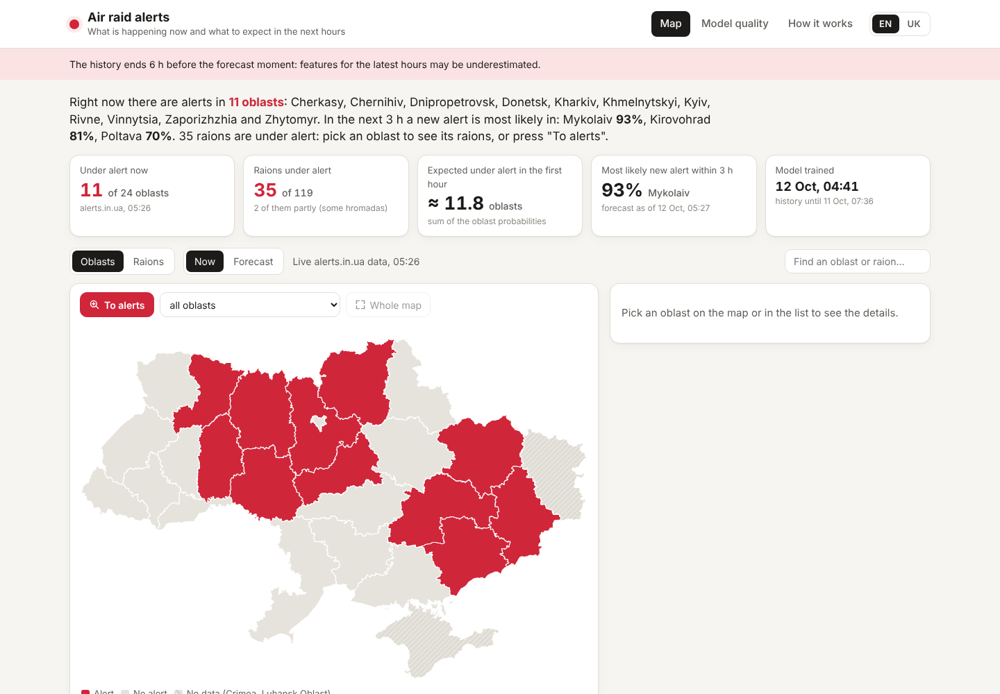

## Що означають відсотки

Сторінка показує кілька різних чисел у відсотках, і кожне підписане, що воно таке.

* **Що прогнозуємо.** Повітряну тривогу **будь-якого типу**: хоч би яка загроза за нею стояла (ударні
  дрони, крилаті ракети, балістика, КАБ…), оголошену будь-де в області (на всю область, на район чи на
  громаду). Записи тривог (волонтерський датасет, alerts.in.ua `air_raid`) не кажуть, яка загроза
  спричинила тривогу, тому окремого прогнозу «для дронів» чи «для ракет» немає. Тому заголовки
  кажуть «Прогноз: повітряна тривога (будь-якого типу)», а легенда мапи «ймовірність повітряної
  тривоги (будь-якого типу)…».
* **«Тривога в N-у год»** (`active`, горизонт h): ймовірність, що територія буде під тривогою хоча б
  мить у 60-хвилинному вікні [момент прогнозу + (h−1) год, момент прогнозу + h год). Тривога, що вже
  триває, рахується. **«Нова тривога за N год»** (`onset`): ймовірність, що нова тривога почнеться між
  моментом прогнозу і моментом через h год (`airraid.features.labels`). Момент прогнозу: перша хвилина
  після останнього опитування alerts.in.ua, тож вікна не вирівняні по годинах (наприклад 11:57–12:57).
* **Відсоток це ймовірність, і вона калібрована.** «70%» означає: з минулих прогнозів близько 70%
  приблизно після 7 з 10 тривога справді була (криві надійності: `reports/figures/reliability.png` і
  графік «Калібрування» на сторінці «Якість моделі»). Це не частка території, не частка години і не
  «впевненість моделі».
* **Слова ризику** це діапазони тієї самої ймовірності (`LEVEL_CUTS` в `app.js`, за показаним округленим
  відсотком): низька менше 15%, помірна 15–39%, висока 40–69%, дуже висока 70% і більше.
* **Графіки історії** («Останні 72 години», календар, дні тижня, типова доба) показують інше: яку частину
  кожної години чи доби область була під тривогою насправді, або частку днів з тривогою. На графіку за
  72 години стовпчики праворуч від «зараз» (з пунктирним контуром) це вже прогнозована ймовірність;
  легенда так і пише: «минуле: частка години під тривогою» і «прогноз: ймовірність тривоги».
* **Тип загрози** («Якщо тривога почнеться, якою вона найімовірніше буде?») це **умовний** розподіл
  P(тип | тривога почнеться) окремої моделі за повідомленнями Повітряних сил: відсотки ділять 100% між
  типами і не є ймовірністю тривоги. Поруч, якщо конвеєр його порахував, стовпчик «ймовірність такої
  тривоги» = P(нова тривога за h) × P(тип | тривога) (`p_onset_<type>` у `type_forecast_now.csv`).
* **Сторінка «Якість моделі»** і блок «Наскільки цьому можна вірити» в панелі району показують оцінки
  якості (перевага над кліматологією за Brier score), а не ймовірності; сторінка каже про це вгорі.
* **Райони**: ті самі визначення на рівні району, з міткою, звідки число (модель району чи похідне від
  прогнозу області).

Біля кожної таблиці прогнозу (усі області, усі райони, панель області, панель району) є короткий
рядок з цим поясненням і кнопка **«?»** з повним визначенням (обидві цілі з їхніми часовими вікнами,
калібрування, пороги слів ризику, чим відрізняються графіки історії і тип загрози). Кнопка працює з
клавіатури (Enter / пробіл відкриває, Esc закриває і повертає фокус) і залишається відкритою під час
щохвилинного оновлення. Заголовки таблиць згруповано: «Ймовірність тривоги (будь-якого типу)
протягом… 1-а год, 2-а год…» і «Ймовірність, що нова тривога почнеться за… 1 год, 2 год…», з точним
часовим вікном у підказці кожного стовпчика.

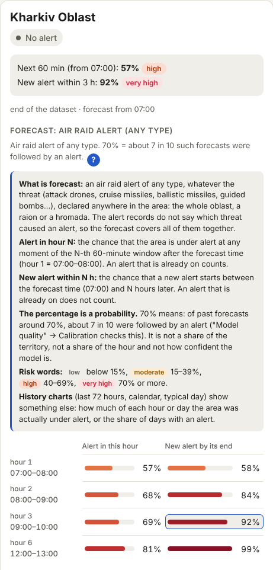

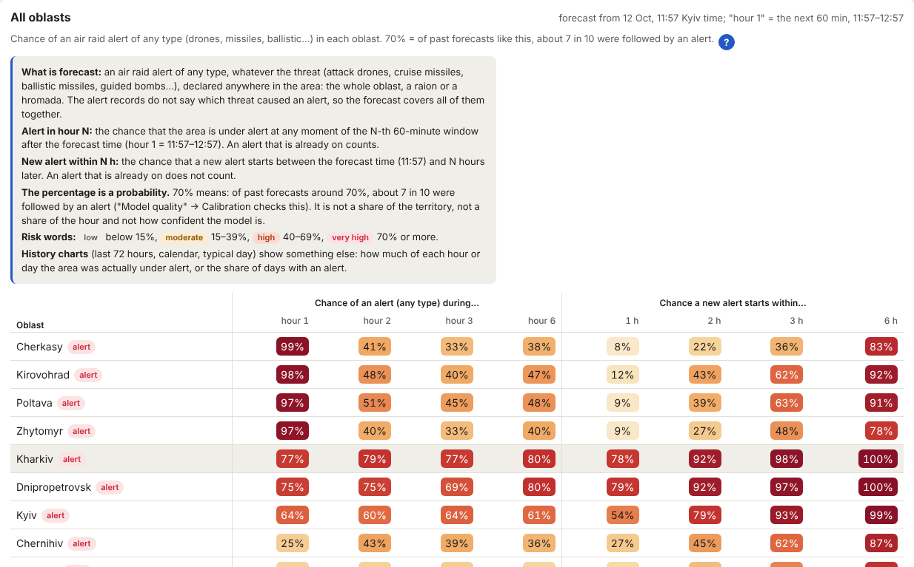

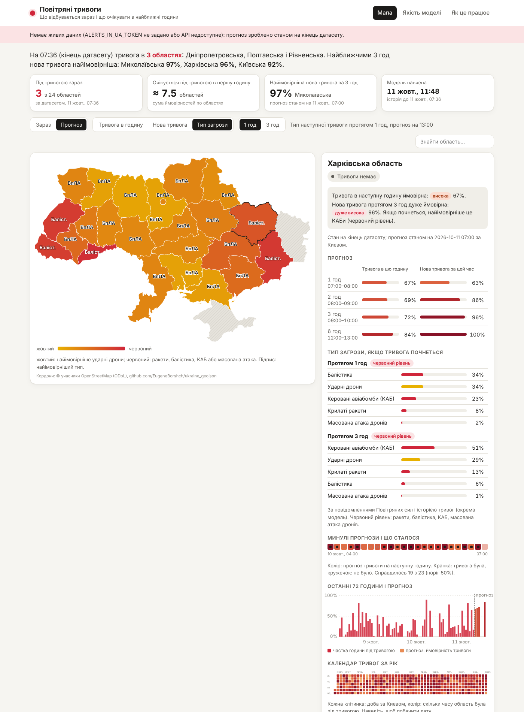

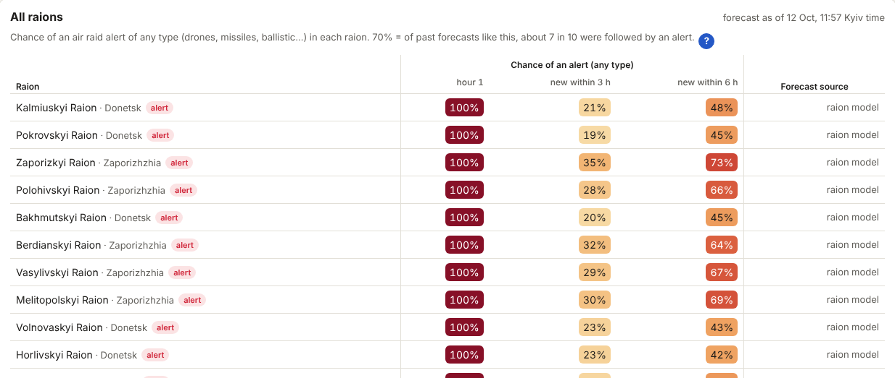 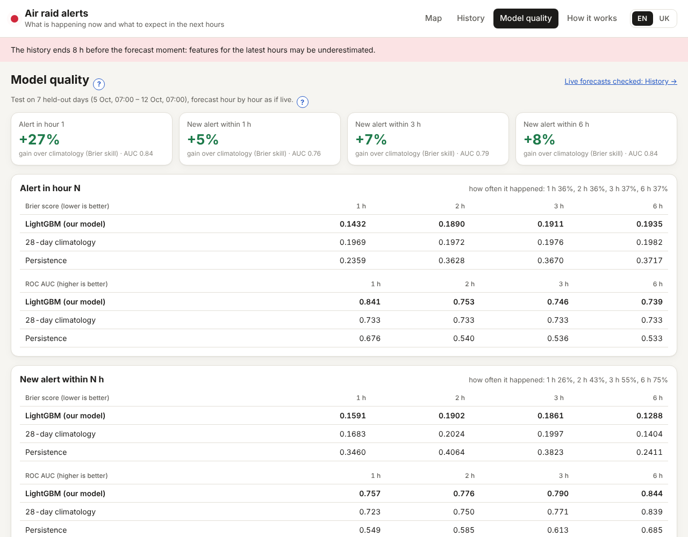

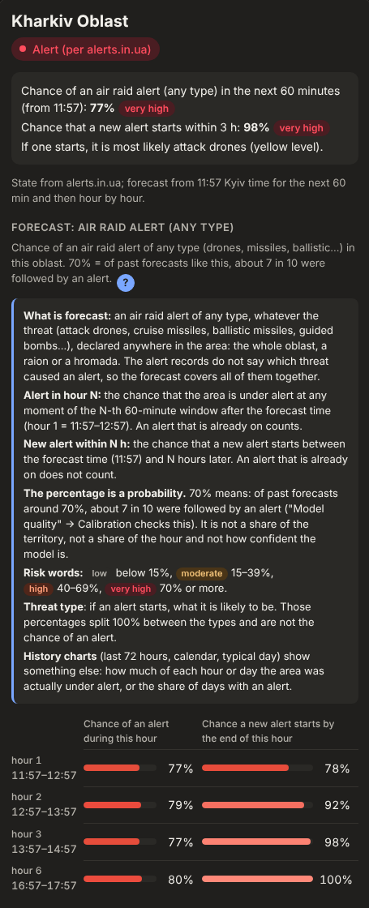 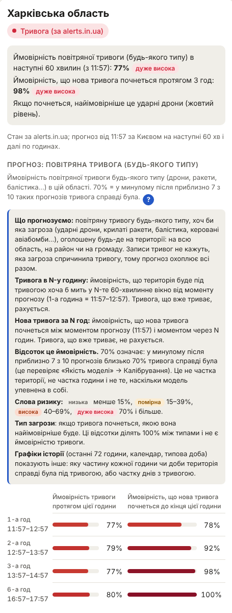 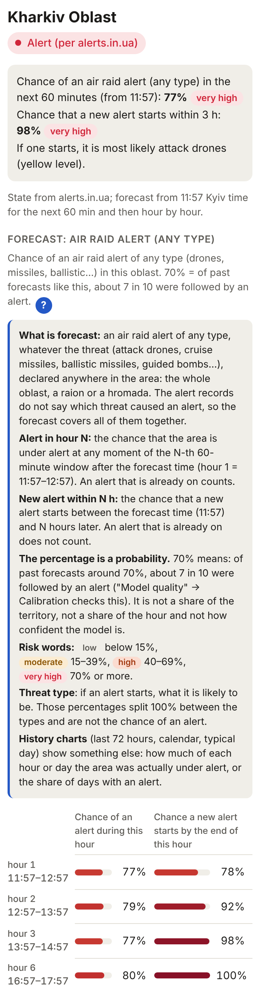

## Історія прогнозів

Вкладка «Історія» (`#history`, між «Мапою» і «Якістю моделі») показує, як справдилися видані
прогнози: скільки перевірено, перевага над кліматологією й персистентністю за 24 год і 7 днів,
стан навчання на історії, перевага по 6-годинних блоках (прогноз і, коли поправка діє, модель
до неї), надійність, погодинний прогноз проти факту для обраної області за 72 год / 7 днів і
останні перевірені прогнози. Пояснення сховано під «?», усі числа в «Усі оцінки». Дані
(`/api/history`, `/api/history/timeline`) завантажуються, лише коли вкладку відкрито.

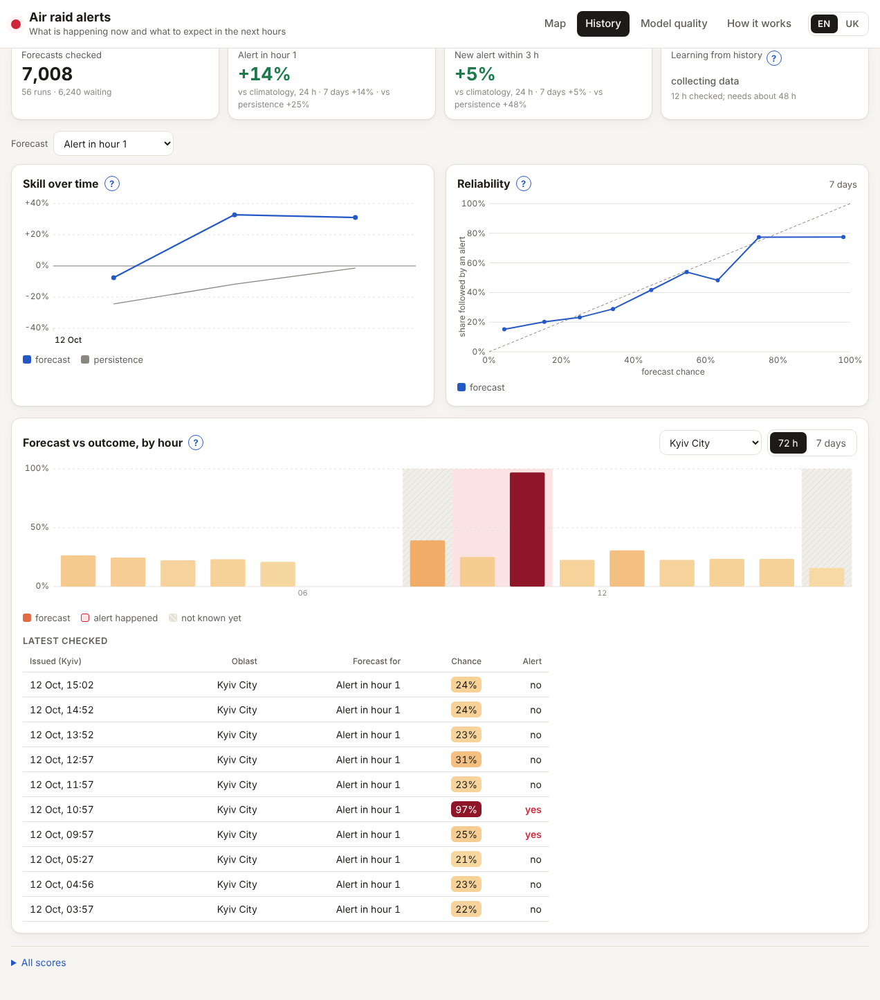

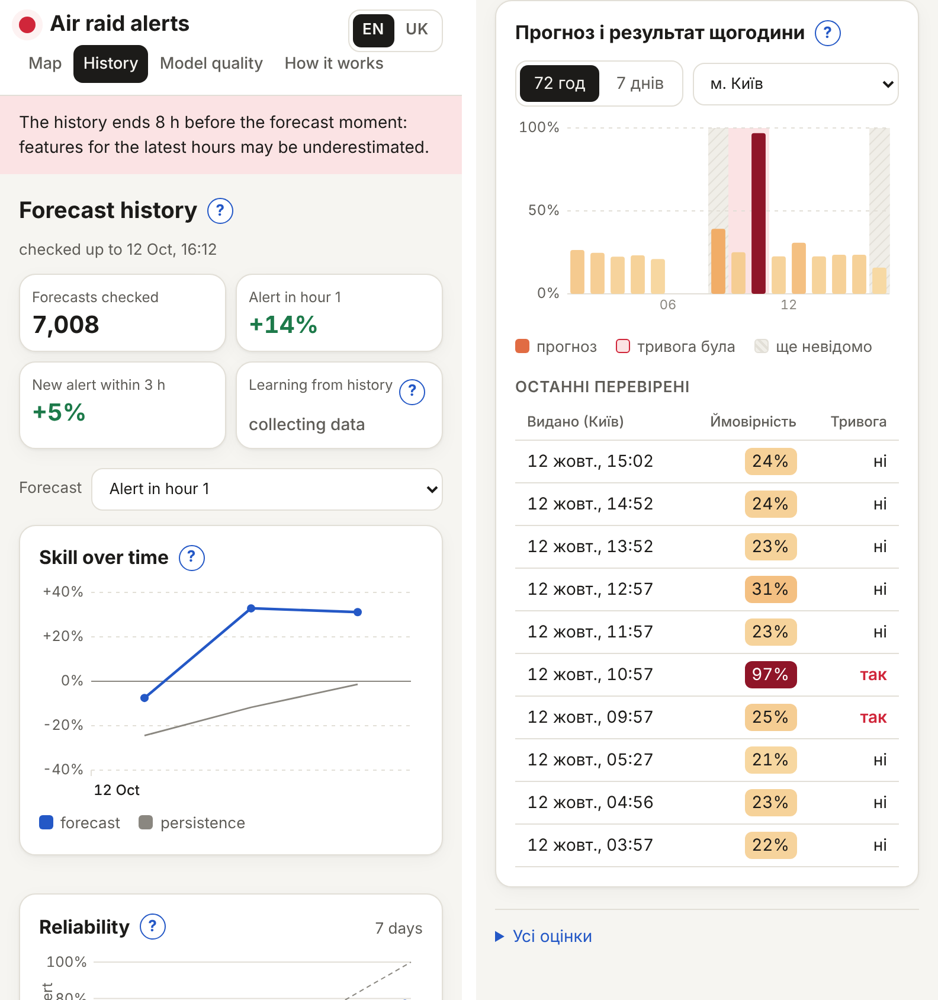 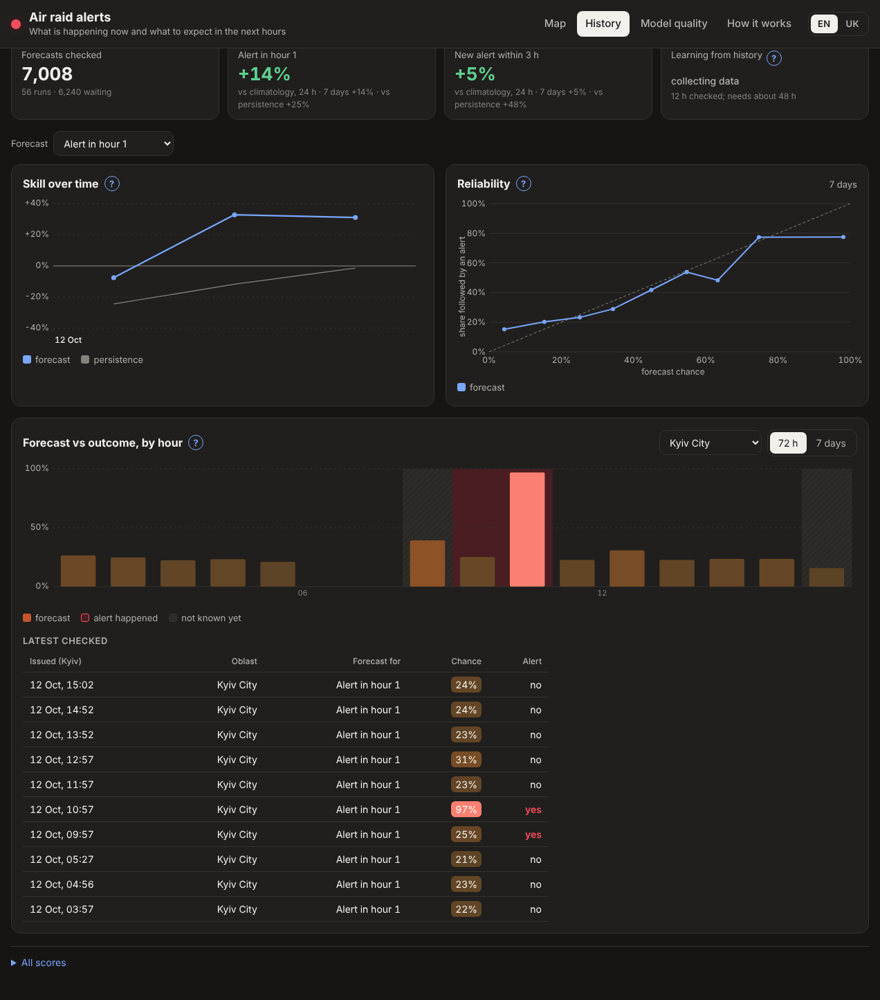

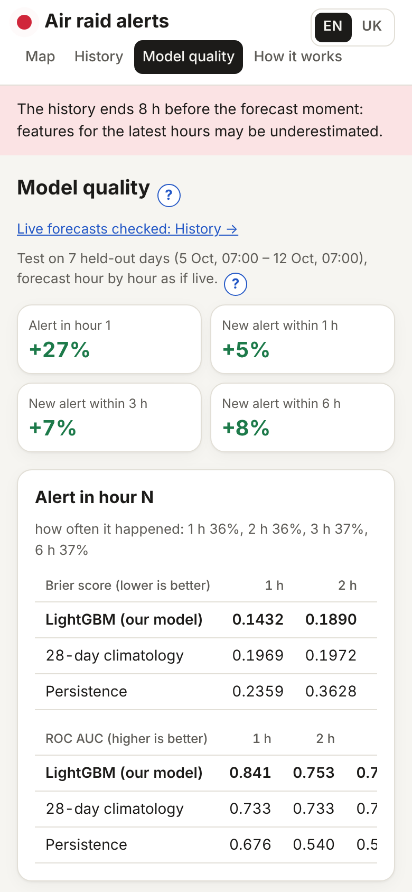

## Що всередині

| Шлях | Що це |
|---|---|
| `src/airraid/` | модельний пакет: дані, ознаки без витоку майбутнього, моделі, метрики (спільний з `run.py` і `predict_now.py`) |
| `src/airraid_app/engine.py` | рушій сервісу і статичного сайту: завантажує історію, віддає набір моделей `airraid.training` (той самий, що навчає `train.yml` і використовує 10-хвилинний конвеєр), рахує прогноз через `airraid.nowcast`; у режимі сховища (`AIRRAID_STORE`) читає опитування, прогнози і перевірку з гілки `live-data` |
| `src/airraid_app/journal.py` | запис живих тривог і журнал виданих прогнозів для перевірки |
| `src/airraid_app/threats.py` | читання прогнозу типу загрози (дрони / ракети / балістика, жовтий / червоний рівень) |
| `src/airraid_app/live.py` | поточний стан: alerts.in.ua (якщо є токен) або стан на кінець датасету |
| `src/airraid_app/raion_engine.py` | шар районів: хто під тривогою по районах, прогноз для кожного району і звідки він |
| `src/airraid/raions.py`, `raion_data.py`, `raion_features.py` | реєстр районів (назви, alerts.in.ua UID), районна історія тривог, ознаки без витоку |
| `src/airraid_app/api.py` | FastAPI: JSON API і роздача інтерфейсу |
| `src/airraid_app/static/` | інтерфейс без збірки: HTML, CSS, JS (`app.js`, переклади `i18n.js`), геометрія мапи (`ukraine-map.json`, `ukraine-map-detail.json`) |
| `scripts/build_map.py` | генерує геометрію областей і районів з OCHA/HDX COD-AB у двох рівнях деталізації (результат уже в репозиторії) |
| `tests/app/` | тести API і рушія на синтетичних даних (офлайн, кілька секунд) |
| `Dockerfile`, `render.yaml`, `deploy/huggingface/`, `.github/workflows/deploy-space.yml` | запуск у контейнері і безкоштовний хостинг |

Ознаки і клас моделі імпортуються з `airraid` без змін, тому сервіс успадковує
перевірку на витік (`tests/test_leakage.py`).

## Запуск локально

```bash
pip install -e ".[dev]"
export ALERTS_IN_UA_TOKEN=...   # необовʼязково; ніколи не комітьте токен
airraid-app serve               # http://localhost:8000, документація API на /docs
```

Перший старт качає датасет (~9 МБ) і навчає 8 моделей: близько 2 хв на 4 ядрах.
Поки модель навчається, сторінка показує прогрес, а API відповідає `503`.
Моделі кешуються в `var/models/` і наступний старт бере їх звідти.

Інші команди: `airraid-app train` (лише навчити), `airraid-app forecast` (прогноз у консоль).

Docker:

```bash
docker build -t airraid .
docker run -p 7860:7860 -e ALERTS_IN_UA_TOKEN=... airraid
```

## API

| Метод | Що повертає |
|---|---|
| `GET /api/health` | стан сервісу (`starting`, `loading`, `training`, `ready`, `error`); `message` українською і `message_code` (код для перекладу в інтерфейсі) |
| `GET /api/state` | хто під тривогою зараз, з якого часу, джерело (`alerts.in.ua` або `dataset`) |
| `GET /api/forecast` | ймовірності `active` (тривога в N-у годину) і `onset` (нова тривога протягом N год) для всіх областей, часові вікна, попередження (`warnings` текстом і `warning_codes` кодами для перекладу) |
| `GET /api/regions/{id}` | одна область: прогноз, погодинна історія за 72 год, типова доба за 28 днів, прогноз проти факту за відкладений тиждень |
| `GET /api/raions` | 119 районів (118 + м. Київ): живий стан (`live`: вся область / район / частина району, громади), прогноз `active`/`onset` на 1-6 год, `method` для кожного значення, частка району (`share`), рівень даних (`tier`) |
| `GET /api/raions/{id}` | один район: те саме плюс прогноз області для порівняння і якість методів на тесті (`evaluation`, з `reports/raions/`) |
| `GET /api/threats` | тип загрози (дрони, масовані дрони, КАБ, ракети, балістика) і рівень жовтий/червоний на 1 і 3 год, якщо підключено `AIRRAID_TYPE_FORECAST` |
| `GET /api/verification` | журнал виданих прогнозів проти факту: Brier проти кліматології, як часто справджувались прогнози ≥50% і <20% |
| `GET /api/history` | вкладка «Історія»: скільки перевірено, Brier прогнозу, моделі до поправки (`brier_raw`), кліматології й персистентності за 24 год і 7 днів, перевага по 6-годинних блоках, надійність, стан навчання на історії (`calibration`) |
| `GET /api/history/timeline` | для кожної області й типу прогнозу: прогноз, виданий щогодини за 7 днів, і чи була тривога (`null`, поки невідомо) |
| `GET /api/metrics` | якість на відкладеному тижні (LightGBM проти кліматології й персистентності), калібрування, по областях; і walk-forward з `reports/metrics_test.csv`, якщо `run.py` вже запускали |

Ідентифікатори областей: `kyiv-city`, `kharkivska`, `lvivska`, ... Районів: `kharkivskyi`,
`chuhuivskyi`, `kamianets-podilskyi`, `kyiv-city`, ... (повний список у `src/airraid/raions.py`).

## Як рахується прогноз

* Момент прогнозу: перша ціла хвилина після останнього опитування alerts.in.ua
  (`airraid.nowcast.origin_after`) або остання повна година датасету (без живих даних).
  «Година 1» це наступні 60 хвилин від цього моменту (для 14:23: 14:23–15:23), «година 2»
  наступні 60 і так далі; погодинні блоки сітки вирівнюються так, щоб закінчуватися в момент
  прогнозу (`airraid.data.grid_start`), тому моделі, навчені на прогнозах від початку
  години, бачать ті самі ознаки (перевірка на витік і калібрування для :10…:50 у README,
  розділ «Sub-hour origins»). Вікна прогнозу в API і на сторінці подано в абсолютному часі.
* З токеном поточні тривоги з alerts.in.ua додаються до історії як «триває зараз», але з
  тим самим визначенням, на якому навчена модель (`airraid.live_alerts`, числа в README,
  розділ «Live data»): тривога будь-якого рівня (область, район, громада, місто) починає
  тривогу області з моменту *останнього* оголошення, відбій у будь-якій частині області її
  закінчує, а без нового оголошення вона вважається завершеною через 1 год (ніколи не довше
  за 12 год, як у `load_alerts`). Тому громада на фронті, яку alerts.in.ua тримає під
  тривогою місяцями, не робить область «під тривогою з березня». Живі записи ніколи не
  потрапляють у навчання і не переписують історію до кінця датасету.
  `/api/state` повертає `active`/`since` (вхід моделі) і окремо `reported` (alerts.in.ua
  зараз показує тривогу десь в області) та `locations` (райони і громади) для показу.
  Якщо API недоступне, сервіс тихо переходить на датасет і пише про це на сторінці.
* Обмеження: датасет оновлюється приблизно раз на добу, а alerts.in.ua дає лише активні
  тривоги. Тривоги між кінцем датасету і першим опитуванням після старту сервісу модель
  не бачить; якщо цей розрив більше 6 год, сторінка попереджає.
* Перед кожним навчанням останні `AIRRAID_HOLDOUT_DAYS` (7) днів відкладаються, модель
  прогнозує їх погодинно, результат іде на сторінку «Якість моделі», після чого модель
  перенавчається на всіх даних.
* Якщо `reports/run_summary.json` від `run.py` є, вікно навчання і кількість дерев
  беруться з вибору на валідації; інакше 12 місяців і 300 дерев.
* **Перевірка виданих прогнозів.** Сервер записує прогноз у журнал
  (`var/state/forecast_journal.parquet`, не частіше ніж раз на 10 хв); у режимі сховища
  журналом є `forecasts` на гілці `live-data`, а результати пише `verify.py` у
  `verification`. Коли прогнозоване вікно минає і про нього є дані, прогноз звіряється з
  фактом тими самими мітками, що й у навчанні (у хвилинах від моменту прогнозу,
  `airraid.verification`): `/api/verification` (останні 24 год і 7 днів: Brier моделі
  проти кліматології, влучність), окрема вкладка «Історія» (`/api/history`,
  `/api/history/timeline`; завантажується, лише коли її відкрито, разом до ~0,5 МБ) і
  смужка «Минулі прогнози і що сталося» в деталях області (один прогноз на годину).
  Сторінка «Якість моделі» показує лише перевірку на відкладеному тижні.
* **Навчання на історії** (`airraid.recalibration`). `verify.py` з перевірених прогнозів
  останніх 7 днів вчить для кожного типу прогнозу невелику поправку ймовірності моделі
  (логістична функція від logit ймовірності, стягнута до «без поправки»). Вона вмикається,
  лише коли є щонайменше 24 години перевірених прогнозів для навчання і ще 12 годин пізнішої
  доби для перевірки, і лише якщо на цій добі Brier зменшився хоча б на 1%. Наступний
  прогноз (`predict_now.py`) бере найновішу поправку, відому на момент прогнозу, і пише
  обидва числа: `p` (показане) і `p_raw` (модель); `verify.py` перевіряє обидва. Райони,
  прогноз яких виводиться з області, отримують показане число області; районні моделі
  без поправки. У режимі сервера без сховища поправки немає.
* **Запис живих тривог.** Кожне опитування alerts.in.ua перетворюється на інтервали тривог
  областей за тим самим визначенням (`var/state/live_alerts.csv`, з `observed_at`
  опитування). Вони закривають розрив між кінцем датасету і «зараз» і для ознак, і для
  перевірки, але тільки після кінця датасету. Якщо сервіс спав довше 15 хв, покриття
  починається заново, щоб не вважати невідомий час спокійним.
* Для GitHub Actions те саме робить точкове сховище на гілці `live-data`
  (`src/airraid/store.py`; `.github/workflows/pipeline.yml` опитує кожні 10 хв,
  `collect.yml` раз на добу тягне історію alerts.in.ua), кожен рядок з моментом, коли він
  став відомий. Сервер теж може читати це сховище: `AIRRAID_STORE=<checkout live-data>`
  (режим сховища: стан, прогноз і перевірка звідти, а не з власних опитувань), якщо поруч
  щось його оновлює (`python -m airraid.collect poll` і `predict_now.py --store` за cron).
* На Hugging Face Spaces диск без платного persistent storage скидається при рестарті,
  тому журнал і запис живих тривог починаються заново після кожного перезапуску Space.
* Фоновий потік сервера оновлює живий стан щохвилини, датасет кожні 6 год і перенавчає
  моделі, коли дані посунулись на добу. Модель зберігається у форматі `airraid.training`
  з версією коду: сервер, конвеєр і статичний сайт ніколи не віддають моделі, навчені
  старим кодом ознак.
* `/api/status`: коли оновлено дані й прогноз. Сторінка показує «Оновлено о ГГ:ХХ» і
  попереджає, якщо даним понад 30 хв.

## Райони


Клік по області (на мапі, у таблиці, пошуком або зі списку над мапою) наближає мапу до неї і
показує її **райони**: червоним райони, де триває тривога на весь район або на всю область,
смугами райони, де тривога лише в частині громад (з токеном alerts.in.ua; без нього живого
стану по районах немає, і сторінка про це пише). Решта областей лишаються приглушеними для
контексту. Панель області показує список районів: чи триває тривога і з якого часу, які громади,
прогноз «тривога в 1-у год», «нова тривога за 3 год» і «за 6 год» і звідки він (мітка методу).
Клік по району відкриває його панель і наближає до нього; «Назад» повертає до області.
**«Уся мапа»** (або Esc на мапі) повертає повний вигляд.

Перемикач **«Області / Райони»** фарбує всю країну по районах (136 районів поділу 2020 року з
межами областей поверх). Кнопка **«До тривог»** наближає мапу до районів під тривогою: до всіх
або лише в області, обраній у списку поруч. У шарі «Прогноз» райони зафарбовано ймовірністю тривоги
(будь-якого типу), а після наближення на них видно числа. У шарі «Тип загрози» райони обраної області
не фарбуються: тип загрози прогнозується лише для областей.


Панель району: чи триває тривога і з якого часу, які громади під тривогою, прогноз на 1, 2, 3 і
6 год і **звідки кожне число**:

* **модель району**: LightGBM на районних даних, яка бачить, які райони під тривогою зараз і як довго,
  стан інших районів області й сусідів, стан області за волонтерськими даними і час доби. Їй потрібен
  лише живий стан районів (одне опитування alerts.in.ua), тому працює з токеном;
* **модель району + історія**: те саме плюс районна історія за 28 днів; працює, коли сховище
  `live-data` покриває останні 29 днів;
* **область × частка району**: прогноз області, помножений на частку тривог області, які зачіпали
  цей район за 28 днів; коли живих районних даних немає. Якщо частка оцінена давно, панель так і пише;
* **прогноз області**: коли районних даних немає зовсім.

Що саме обирати для кожної ситуації, вирішує валідація в `raion_run.py`; панель показує ще й
як цей метод спрацював на тесті (усі райони і райони цієї області). Числа і метод: README, розділ
«Raion level». Посилання: `#region/<id>`, `#raion/<id>`. Мапа і панелі працюють на телефоні.

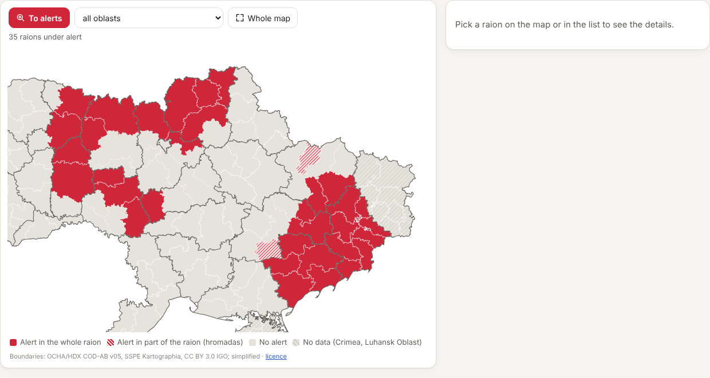

### Межі

Межі областей і районів: OCHA/HDX COD-AB v05 (ДНВП «Картографія», CC BY 3.0 IGO). Спільні межі
розрізано на дуги, і кожна дуга спрощується один раз, тому сусіди не мають щілин і накладань;
**області отримано злиттям районів** (ті самі дуги), тож межі областей і районів збігаються, а
м. Київ має справжній контур. Проєкція: конічна рівнокутна Ламберта. Два рівні деталізації:
`ukraine-map.json` (вся країна, допуск ~0,3 км; 150 КБ, 51 КБ gzip) завантажується зі сторінкою,
`ukraine-map-detail.json` (допуск ~45 м; 290 КБ, 83 КБ gzip) лише тоді, коли мапа наближається.
Раніше мапа областей (OpenStreetMap, 33 КБ) була грубою і не збігалася з мапою районів (370 КБ,
127 КБ gzip), яка вантажилася окремо.

### Статистика області

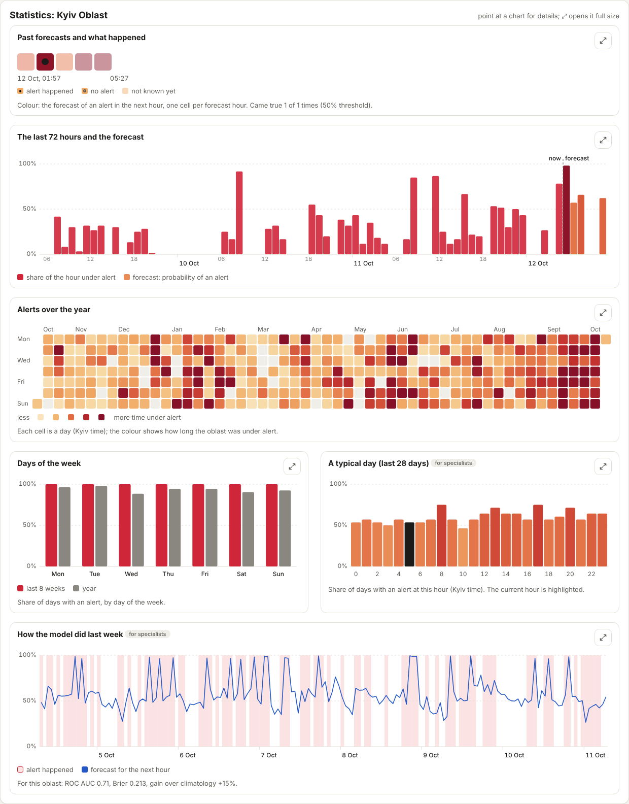

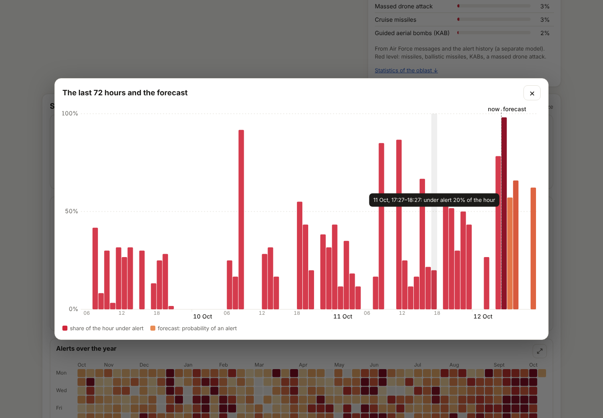

Під мапою на всю ширину сторінки: минулі прогнози і що сталося, останні 72 години і прогноз,
календар тривог за рік, дні тижня, типова доба і як модель вгадувала минулого тижня. Графіки історії
показують частку часу під тривогою (факт), а не ймовірність; на графіку за 72 години минуле і прогноз
мають різні підписи в легенді й підказках, а прогнозні стовпчики обведено пунктиром. Графіки
малюються в пікселях під ширину екрана (читабельні підписи), наведення показує значення, кнопка ⤢
відкриває графік на весь екран. На телефоні графіки йдуть один під одним, календар ділиться на
два рядки.

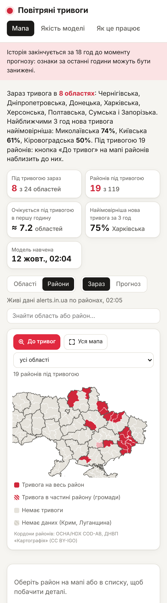

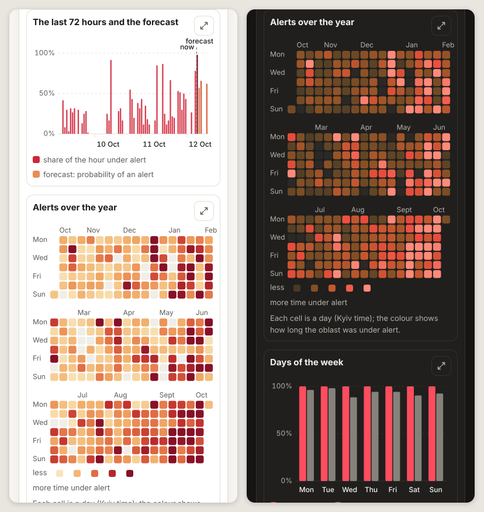

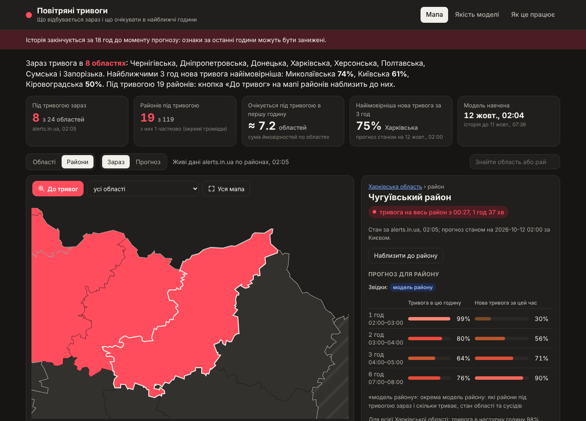 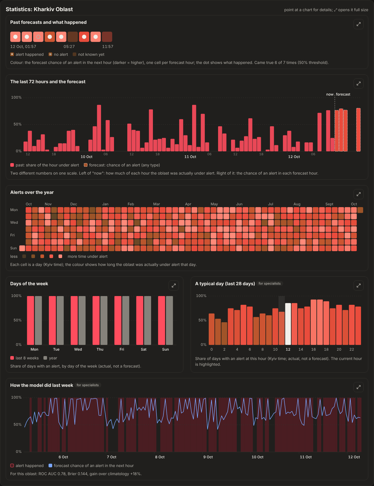

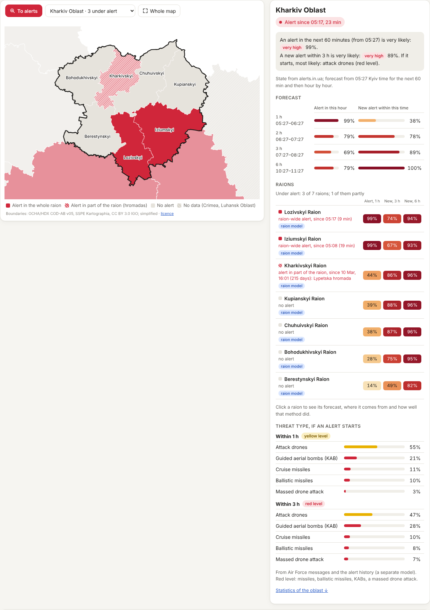

## Мова інтерфейсу

Типово інтерфейс англійською (рішення власника, незалежно від мови браузера). Перемикач **EN / UK**
у заголовку вмикає українську; вибір запамʼятовується в цьому браузері (`localStorage`, сторінка
працює й без нього), а посилання може задати мову явно: `?lang=uk` або `?lang=en`. Усі тексти
інтерфейсу лежать у `src/airraid_app/static/i18n.js` (англійська і українська), дати й час
форматуються `Intl` (`en-GB` / `uk-UA`, час Києва). Назви: області англійською як «Kyiv Oblast»,
райони за англійськими назвами COD-AB («Obukhivskyi Raion»), громади й міста з alerts.in.ua
транслітеровано за офіційною транслітерацією (2010); в українському режимі все українською.
Сервер віддає тексти, що доходять до інтерфейсу, ще й кодами (`warning_codes`, `message_code`),
а мітки методів і типів загроз інтерфейс перекладає за їхніми кодами. Перевірки:
`tests/app/test_i18n.py` (кожен ключ є в обох мовах, ті самі параметри) і
`tests/app/test_ui_browser.py` (сторінка в Chromium: англійська типово, у режимі EN немає
кирилиці, перемикач працює і запамʼятовується, на 390 px немає горизонтальної прокрутки).

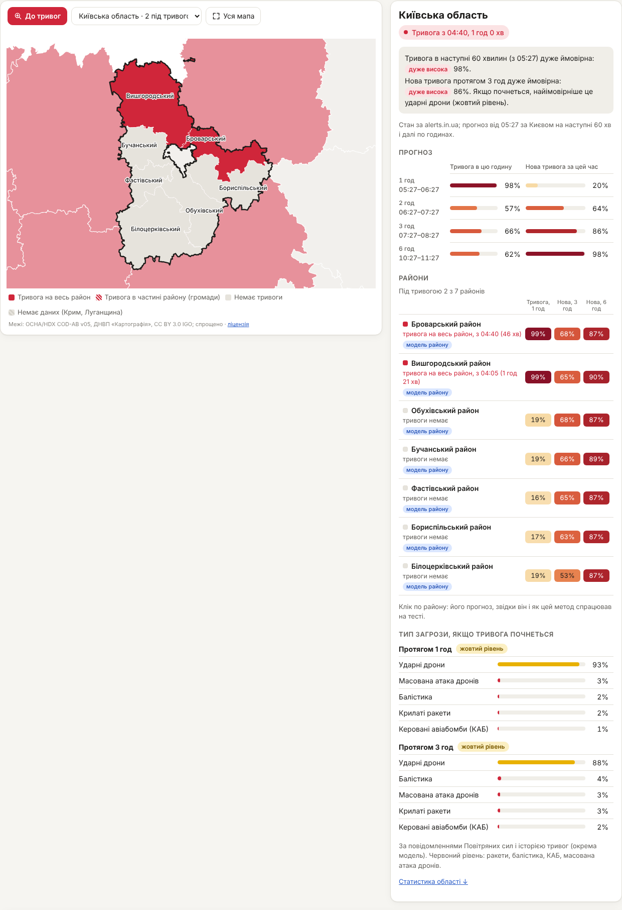

Знімки екрана зроблено Playwright + Chromium на статичній збірці з реальними даними (артефакт
GitHub Pages від 12 жовтня 2026, 05:27 за Києвом; знімки з поясненням відсотків, мапа прогнозу,
тип загрози, статистика, панель району і «Українською»: артефакт від 12 жовтня 2026, 11:57 за Києвом).

## Тип загрози

Окрема модель (`threat-type/`, PR #5) оцінює, яким буде наступна тривога: ударні дрони
(жовтий рівень) чи ракети, балістика, КАБ або масована атака дронів (червоний). Вона потребує
історії повідомлень Повітряних сил, тому працює в GitHub Actions: 10-хвилинний конвеєр запускає
її після основного прогнозу (той самий момент прогнозу, P(нова тривога) × P(тип | тривога)) і
публікує `type_forecast_now.csv` поруч зі статичною сторінкою. Застосунок лише читає цей файл
(`AIRRAID_TYPE_FORECAST`, локальний шлях або URL, оновлення кожні 10 хв) і показує шар
«Тип загрози» на мапі та розподіл типів у деталях області. Без файлу шар просто прихований.
Це умовна оцінка («якщо тривога почнеться, якою вона буде»): відсотки ділять 100% між типами, і
сторінка прямо пише, що це не ймовірність тривоги; сам прогноз тривоги охоплює всі типи.

## Налаштування (змінні середовища)

| Змінна | Типово | |
|---|---|---|
| `ALERTS_IN_UA_TOKEN` | – | токен alerts.in.ua для живого стану |
| `PORT` | 8000 (7860 у Docker) | порт |
| `AIRRAID_DATA_PATH` | `data/raw/volunteer_data_en.csv` | де лежить датасет |
| `AIRRAID_MODEL_DIR` | `var/models` | набір моделей (`airraid.training`; конвеєр відновлює його з кешу Actions) |
| `AIRRAID_STORE` | – | checkout гілки `live-data`: режим сховища (стан, прогноз і перевірка з нього) |
| `AIRRAID_STATE_DIR` | `var/state` | журнал прогнозів і запис живих тривог |
| `AIRRAID_REPORTS_DIR` | `reports` | звідки читати `run_summary.json` і `metrics_test.csv` |
| `AIRRAID_TYPE_FORECAST` | `threat-type/reports/type_forecast_now.csv`, якщо є | прогноз типу загрози (шлях або URL), напр. `https://ivansnezhok.github.io/air-raid-forecast-ua/type_forecast_now.csv` з GitHub Pages |
| `AIRRAID_TEXT_ROOT` | не задано | checkout гілки `text-data` (архів Telegram, має бути доступний на запис): якщо архів покриває момент прогнозу, прогнозує модель з Telegram-сигналами, інакше модель лише на історії тривог; яка саме, видно в `/api/forecast` → `model.served`, `model.text_status` |
| `AIRRAID_TEXT_TRAIN` | `1` | `0`: не навчати модель з Telegram-сигналами в цьому процесі, а брати збережену окремим завданням (`python -m airraid.text.serving train`); якщо її немає, прогнозує модель лише на історії (`model.text_status` пояснює) |
| `AIRRAID_DOWNLOAD` | `1` | качати свіжий датасет при старті й оновленні |
| `AIRRAID_TRAIN_MONTHS` / `AIRRAID_MAX_TRAIN_MONTHS` | 12 / 24 | вікно навчання |
| `AIRRAID_TREES` | 300 | дерев на модель |
| `AIRRAID_HOLDOUT_DAYS` | 7 | відкладений тиждень |
| `AIRRAID_LIVE_REFRESH_S` | 60 | як часто питати alerts.in.ua |
| `AIRRAID_DATA_REFRESH_H` / `AIRRAID_RETRAIN_H` | 6 / 24 | оновлення датасету / перенавчання |
| `AIRRAID_LGB_THREADS` | кількість ядер | потоки LightGBM |
| `AIRRAID_OFFICIAL_PATH` | `data/raw/official_data_en.csv` | «офіційний» файл тривог по районах (качається сам, якщо `AIRRAID_DOWNLOAD=1`) |
| `AIRRAID_STORE` | – | шлях до чекауту гілки `live-data`: районна історія alerts.in.ua після 7 вересня 2026 |
| `AIRRAID_RAION_MODELS` | `1` | навчати моделі районів (`0` на хостах з 512 МБ: тоді райони рахуються від прогнозу області) |
| `AIRRAID_RAION_TRAIN` | `1` | `0`: ніколи не навчати моделі районів у цьому процесі, а брати збережені окремим завданням (`RaionForecaster.save` / `load_saved`); якщо їх немає, прогноз району = прогноз області × частка району (`models_source: "none"` у `/api/raions`) |
| `AIRRAID_RAION_MODEL_DIR` | `<AIRRAID_MODEL_DIR>/raions` | звідки читати збережені моделі районів |

## Безкоштовний хостинг

**Рекомендовано: Hugging Face Spaces (Docker).** Безкоштовний CPU-контейнер: 2 vCPU, 16 ГБ RAM,
засинає лише після 48 год без відвідувань. Навчання на старті займає кілька хвилин.

1. У цьому репозиторії: Settings -> Secrets and variables -> Actions: секрет `HF_TOKEN`
   (токен Hugging Face з правом запису, https://huggingface.co/settings/tokens) і змінна
   `HF_SPACE` (наприклад `ivansnezhok/air-raid-forecast`).
2. Запустити `deploy-space` вручну (Actions -> deploy-space -> Run workflow) або запушити в
   `main`. Workflow сам створює Space (SDK Docker), якщо його немає, і копіює туди секрет
   `ALERTS_IN_UA_TOKEN`, якщо він заданий у репозиторії.
3. Викладання йде через Hub API (`.github/scripts/deploy_space.py`), а не `git push`: Hub
   відхиляє git-пуші з бінарними файлами (графіки, parquet) без його сховища великих файлів.

**Альтернатива: Render.** New -> Blueprint -> цей репозиторій, конфіг у `render.yaml`.
Безкоштовний план засинає після 15 хв без трафіку (холодний старт з перенавчанням) і має
512 МБ памʼяті, тому там вікно навчання зменшене до 6 місяців.

Основна вітрина без сервера: статична сторінка на GitHub Pages, яку кожні 10 хвилин
збирає `pipeline.yml` (нижче).

## Тести

```bash
pytest tests/app          # API, рушій, геометрія мапи, переклади; синтетичні дані, офлайн (у т.ч. шар районів)
pytest tests/test_leakage.py   # перевірка на витік, качає датасет
pytest tests/test_raion_leakage.py   # витік у районних ознаках, качає «офіційний» файл
```

Межі областей і районів: OCHA/HDX COD-AB v05 (ДНВП «Картографія»), CC BY 3.0 IGO, див.
`src/airraid_app/static/ukraine-map.LICENSE.txt`. UID районів alerts.in.ua: опубліковані alerts.in.ua
(також у MIT-клієнті alerts_in_ua).

## Static site on GitHub Pages

`python scripts/build_static_site.py site` runs the engine once and writes the UI
plus precomputed `api/*.json` (state, forecast, regions, raions, metrics,
verification, threats, status) that replace the `/api/*` calls. The threat-type layer
is hidden when `threat-type/reports/type_forecast_now.csv` is missing.

In the 10-minute pipeline (`.github/workflows/pipeline.yml`, README "Automation")
it runs in store mode (`AIRRAID_STORE=live-data`, `AIRRAID_MODEL_DIR=var/models`):
no training and no second forecast. It serves the bundle `predict_now.py` used
(with the raion models in `<models>/raions` and the text models in `<models>/text`,
`AIRRAID_RAION_TRAIN=0`, `AIRRAID_TEXT_TRAIN=0`), the forecast `predict_now.py`
logged to the store for the newest origin, the live state of the newest poll (the
map's "now" is the forecast's `active_now`; the raion state comes from the same poll),
the raion history of the store, and the verification `verify.py` wrote to the store;
`scripts/pipeline.py status` adds `api/status.json` (last update, step timings, data
ends, model training time, served model, raion method, verification counts). Enable
Pages once in Settings -> Pages -> Source: GitHub Actions.
